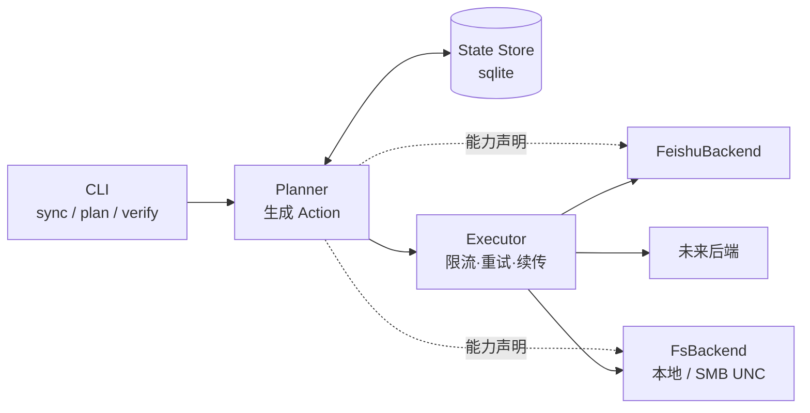

# weftsync 项目计划

> 状态：**需求已获取 · 架构待确认 · 未写代码**
> 最后更新 2026-11-04 ／ 决策理由见 `docs/decisions.md`

---

## 1. 需求

| # | 需求 | 要点 |
|---|---|---|
| R1 | **认证**：飞书云盘采用**飞书应用权限**（app_id + app_secret） | 不用用户 OAuth 交互登录 |
| R2 | **主方向**：本地 → 飞书云盘**单向同步** | |
| R3 | **同步模式**：完全同步、仅增量同步等可区分 | |
| R4 | **多本地机器** → 同一云盘 | 多源汇聚，需处理互相覆盖 |
| R5 | **双向同步**尽力而为；做不到则单独提供**云盘 → 本地拉取** | 因飞书云盘结构不同 |
| R6 | **后端可插拔**：默认飞书，未来换 SMB / 其他网盘 | 架构期就要预留 |
| R7 | **多网盘同步**（可选，非 pair） | 高级功能 |
| R8 | 可借鉴现有轮子，甚至二次开发 | |

---

## 2. 已核实的技术事实（附来源，非推测）

> 全部来自飞书开放平台官方文档，2026-11-04 抓取。

| # | 事实 | 对设计的影响 |
|---|---|---|
| F1 | `tenant_access_token` 通过 `POST /open-apis/auth/v3/tenant_access_token/internal`（body: app_id + app_secret）获取，**有效期 2 小时**；剩余不足 30 分钟时调用会**返回新 token 且旧 token 仍有效** | 必须做 token 缓存 + 提前刷新，不能每请求都换 |
| F2 | **应用身份访问个人云盘文件夹必须先人工授权**：① 应用开启「机器人」能力 ② 建群并把应用拉进群 ③ 在飞书文档里把目标文件夹**共享给该群** | 代码无法解决，必须写进部署文档；换文件夹就要再操作一次 |
| F3 | 列目录 `GET /open-apis/drive/v1/files`，`page_size` 最大 200，**不递归**，需自己逐层递归 | 大目录树要自己遍历，注意限流 |
| F4 | 列目录返回：`token`、`name`、`type`(doc/sheet/bitable/mindnote/file/docx/folder/shortcut)、`parent_token`、`url`、`created_time`、`modified_time`、`owner_id`<br>**没有 size，没有 content hash** | ⚠️ 增量判断只能靠 `modified_time`（秒级）；无法用 hash 校验内容 → **本设计最大约束** |
| F5 | 上传 `POST /open-apis/drive/v1/files/upload_all`，**单文件 ≤ 20MB**；参数：`file_name`/`parent_type=explorer`/`parent_node`/`size`/`checksum`(Adler-32, 可选)；超限走分片上传 | 大文件必须实现分片流程 |
| F6 | 上传限流 **5 QPS、10000 次/天**；列目录 **20 QPS** | 大批量同步必须限速 + 可续传 |
| F7 | 容量硬限制：**目录最深 15 层**、**单层最多 1500 节点**、**单棵树最多 40 万节点** | 深/大目录会失败，需前置校验 |
| F8 | 权限 scope：`drive:drive`（读写管理全部）/ `drive:drive:readonly` / `drive:file` / `drive:file:upload` | 最小权限：上传场景给 `drive:file:upload` |
| F9 | 错误码：`1061004 forbidden`、`1061045 can retry`、`1062009 size 不一致`、`1061044 parent_node 不存在`、`1062506 超目录深度`、`1062507 超单层节点数` | 需分类重试策略 |
| F10 | 飞书云盘**只能按 token 寻址**（folder_token / file_token），没有真实路径；Wiki 不支持直接上传，须先传到文件夹再 move | 必须维护「逻辑路径 ↔ token」映射 |

---

## 3. 上线前必须实测的 5 件事（E1–E5）

> 无法从文档确定、但会决定架构的点。写核心代码前必须先测。
> 需要真实租户 + 应用凭据；没有则先用 mock backend 走通链路。

| # | 待验证 | 为什么关键 | 若答案为「否」的应对 |
|---|---|---|---|
| **E1** | 已有 `file` 文件能否**原地更新内容**（保持 file_token / 分享链接不变）？ | 决定增量是「覆盖」还是「删+传」 | 删+传 → 链接会变，须在文档告知 |
| **E2** | 同一文件夹内是否允许**同名文件**共存？ | 决定「按名字映射」是否唯一可靠 | 允许 → 必须靠 token 映射，名字仅作展示 |
| **E3** | `file` 类型是否真拿不到 size？（能否用 download 的 `Content-Length` 补） | 决定增量能否用 size 做第二判据 | 拿不到 → 只能 mtime，接受误判 |
| **E4** | 按 F2 授权后，应用是否真有**写权限**（不仅是读）？ | 决定 R2 是否成立 | 不行 → 前提崩塌，需换 user token 或共享空间 |
| **E5** | `modified_time` 的更新时机：上传时写？移动/改名会变吗？ | 决定冲突检测是否可信 | 不可信 → 需自建 token→内容指纹映射 |

---

## 4. 核心设计难点

### 4.1 难点一：飞书与 SMB 能力差异巨大，「可插拔」不是抽象基类就够

| 能力 | 本地 / SMB(UNC) | 飞书云盘 |
|---|---|---|
| 寻址 | 真实路径 | 只有 token，需自己维护路径↔token |
| size | ✅ | ❓（F4 未返回） |
| content hash | ✅ 任意算法 | ❌ 服务端无 |
| mtime | ✅ 可读可写 | 只读、秒级、口径不明 |
| 原地覆盖 | ✅ | ❓（E1） |
| 原子 rename | ✅ | 只能 move，且可能改 mtime |
| 递归列目录 | ✅ 一次遍历 | ❌ 逐层 API + 限流 |
| 限流 | 无 | 上传 5 QPS |

**结论**：后端接口必须带**能力声明（capabilities）**，同步引擎按能力**降级决策**，
而不是假设所有后端行为一致。这是 R6 能否落地的分水岭。

### 4.2 难点二：增量同步没有可靠判据

飞书端只有秒级 `modified_time`，没有 size / hash。「远端是否变化」只能看时间戳，存在三类误判：
内容变了但 mtime 没变、mtime 变了但内容没变、同秒内多次修改。

**对策**：本地维护 **state 快照**（上次成功同步时的远端 mtime + 本地 size/mtime/hash），
用三方对比而非单看远端：

```
本地当前指纹   vs  state.本地指纹    → 本地是否变
远端当前 mtime vs  state.远端 mtime  → 远端是否被别人变
```

### 4.3 难点三：多机器同步同一云盘 = 天然写冲突

R4 要求多台机器同步到同一云盘。没有分布式锁，必须定义冲突策略：

| 策略 | 行为 |
|---|---|
| `skip`（默认） | 远端 mtime 比 state 新 → 别人改过 → 跳过并告警 |
| `overwrite` | 一律用本地覆盖 |
| `keep-both` | 远端改名为 `name.conflict-<机器名>-<时间>` 后再传 |

### 4.4 难点四：删除是单向同步里最危险的动作

「完全同步」与「镜像」的区别就在是否删除远端多余文件。**默认绝不删除**，
必须显式 `--delete`，并加 `--max-delete=N` 熔断（超 N 个即中止），
防止「本地目录配错 → 一键清空云盘」。

---

## 5. 架构草案



### 5.1 后端接口（关键：带能力声明）

```python
@dataclass(frozen=True)
class Entry:
    path: str            # 相对根的逻辑路径，统一 '/' 分隔
    kind: Literal["file", "dir"]
    size: int | None     # 后端不提供则 None
    mtime: int | None    # Unix 秒；不提供则 None
    ref: str | None      # 后端内部 ID（飞书 = token；FS = None）

@dataclass(frozen=True)
class Caps:
    has_size: bool
    has_mtime: bool
    has_hash: bool
    can_update_in_place: bool
    can_set_mtime: bool
    recursive_list: bool
    max_single_upload: int      # 飞书 20MB
    rate_limit_qps: float | None

class Backend(Protocol):
    name: str
    caps: Caps
    def list(self, path: str) -> Iterator[Entry]: ...   # 逻辑上递归
    def stat(self, path: str) -> Entry | None: ...
    def mkdirs(self, path: str) -> None: ...
    def upload(self, local: Path, path: str, overwrite: bool) -> Entry: ...
    def download(self, path: str, local: Path) -> None: ...
    def delete(self, path: str) -> None: ...
    def move(self, src: str, dst: str) -> None: ...
```

两个内置后端：

- `FsBackend` —— 本地路径与 **SMB 的 UNC 路径（`\\server\share\...`）可直接用**，无需额外库。
  能力近似「满级」，同时可作引擎的基准对手。
- `FeishuBackend` —— 内部维护 path↔token 映射（落 state），处理分片、限流、token 刷新。

### 5.2 引擎分两段：计划 → 执行

```python
@dataclass
class Action:
    op: Literal["mkdir", "upload", "update", "delete", "skip", "conflict"]
    path: str
    reason: str        # 为什么这么判；dry-run 时打印
    local: Path | None = None
```

- `plan()` 只读、不写远端 → 天然支持 `--dry-run`，也天然可测
- `apply()` 按 op 执行并写 state
- 每个 Action 带 `reason`，出问题能解释「为什么传/为什么跳过」

### 5.3 目录结构

```
src/weftsync/
  cli.py                 # typer：sync / plan / verify / config
  config.py              # TOML 配置 + 凭据从环境变量读
  model.py               # Entry / Caps / Action / PairSpec
  state.py               # sqlite：路径↔token、上次同步快照
  backends/
    base.py              # Protocol + Caps
    fs.py                # 本地 / SMB(UNC)
    feishu/
      auth.py            # tenant_access_token 缓存与刷新
      transport.py       # 限流、重试、错误码分类
      api.py             # 各 endpoint 薄封装
      backend.py         # 实现 Backend
  engine/
    planner.py
    executor.py
tests/
  test_planner.py
  test_fs_backend.py
  test_feishu_backend_mock.py
```

### 5.4 配置草案

```toml
[[pair]]
name = "work-docs"

[pair.local]
root = "D:/work/docs"

[pair.remote]
backend = "feishu"
root_token = "fldcnXXXXXXXX"
# 或 backend = "fs"
# root = "//nas/share/docs"

[pair.policy]
mode = "incremental"        # incremental | full
delete_extra = false        # full 模式是否镜像删除
max_delete = 50             # 熔断
conflict = "skip"           # skip | overwrite | keep-both
exclude = ["**/.git/**", "**/node_modules/**", "**/*.tmp"]

[feishu]
app_id_env = "WEFTSYNC_FEISHU_APP_ID"
app_secret_env = "WEFTSYNC_FEISHU_APP_SECRET"
```

多网盘（R7）天然支持：写多段 `[[pair]]`，同一 `local.root` 指向多个 remote 即可。

---

## 6. 技术选型建议

| 方案 | 优点 | 缺点 | 判断 |
|---|---|---|---|
| **Python 3.11 + 自研引擎** | `.venv` 已就绪；OpenAPI 用 httpx 直连；SMB 用 UNC 零依赖；迭代快 | 大目录遍历性能一般 | ✅ 首选 |
| rclone + 自写飞书 backend | 白拿成熟同步引擎 | 要写 Go backend；rclone 无官方飞书支持；多 target 非其强项 | ❌ 成本高于收益 |
| 现成第三方飞书同步工具 | 起步快 | 多为 user token + 双向，不符合「应用权限 + 单向 + 可插拔」 | ⚠️ 仅参考 |

> 依赖极简：`httpx`（HTTP）、`typer`（CLI）、`tomllib`（3.11 内置）、`pytest`。
> 不引入飞书官方 SDK（`lark-oapi`）—— 它把 token 管理藏起来，妨碍做限流与错误分类。

---

## 7. 里程碑

| 里程碑 | 内容 | 验收标准 |
|---|---|---|
| **M0** | 实测 E1–E5，锁定飞书能力边界 | 五个答案写入 `docs/feishu-probe.md`，附原始返回 |
| **M1** | `FsBackend` + Planner + dry-run | 本地两目录间跑出正确 Action 列表，单测覆盖 |
| **M2** | `FeishuBackend` 只读（列目录/下载） | 完整列出云盘目录树，含 path↔token 映射 |
| **M3** | 上传（小文件 + 分片）+ 限流 + 重试 | 本地目录单向同步到云盘，可中断续传 |
| **M4** | 增量 + state store | 二次运行只传增量；重复运行零上传 |
| **M5** | 删除/镜像 + 冲突策略 + 熔断 | `--delete` 受 `--max-delete` 保护，冲突可复现 |
| **M6** | 拉取（云盘 → 本地） | R5 保底需求达成 |
| **M7** | 双向同步（如 M0–M6 顺利） | 待评估 |
| **M8** | 多 target 同步（R7） | 一次运行推多个后端 |

---

## 8. 待确认问题

| # | 问题 | 影响 |
|---|---|---|
| Q1 | 是否有可用的飞书应用（app_id/app_secret）与测试文件夹？能否把文件夹共享给应用所在的群？ | 决定能否做 M0；否则只能 mock |
| Q2 | 目标云盘是**个人云盘**、**共享空间（团队）**还是**知识库(wiki)**？ | 三者授权与上传方式不同；wiki 不支持直接上传 |
| Q3 | 同步对象是**普通文件**，还是也含飞书原生文档（docx/sheet/bitable）？ | 原生文档无法按「文件」语义同步 |
| Q4 | 多台机器同步同一云盘，是**同一个人多设备**还是**多人**？ | 决定冲突策略默认值 |
| Q5 | 技术栈用 Python 3.11 可以吗？ | 决定 M1 起步速度 |

---

## 9. 本仓库约束

- 位于 OneDrive 同步目录内 → `.git` 可能被锁定，遇 `index.lock` 先查 OneDrive
- PowerShell 5.1：命令用 `;` 串联；`.ps1` 一律纯 ASCII
- 临时产物写 `.scratch/`，不写 `%TEMP%`
- 凭据**只从环境变量读**，绝不进配置文件、绝不入库
