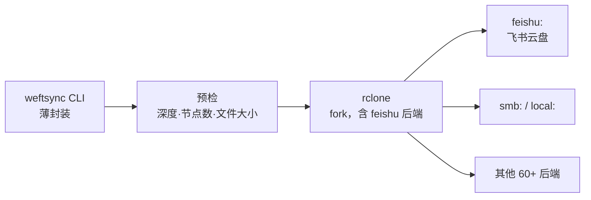

# weftsync 项目计划

> 状态：**需求访谈完成（A1–A25）· 技术路线已定（rclone 库依赖，不 fork）· M0 实测完成 · 宪法已转正 v1.0.0**
> 最后更新 2026-11-06 ／ 决策理由见 `docs/decisions.md` ／ 工程准则见 `.specify/memory/constitution.md`

---

## 0. 当前阶段

> **Feature 进度以 [`docs/roadmap.md`](docs/roadmap.md) 为准**（F1–F10 及各自验收标准）。
> 那是防止遗忘的唯一权威来源，本文件不重复维护该表。

| 步骤 | 状态 |
|---|---|
| 需求访谈（A1–A25） | ✅ 完成，无待确认项 |
| 技术调研与实测（E1–E6、权限矩阵、分片上传、删除不可逆） | ✅ 完成 |
| 项目宪法 | ✅ **已转正 v1.0.0**（2026-11-06，8 条通用准则 + 项目约束） |
| 路线图 | ✅ `docs/roadmap.md`（F1–F10，含逐条验收标准） |
| `speckit-specify`（F1） | 🔄 **进行中** |
| `speckit-plan` / `tasks` / `implement` | ⬜ 待 spec 完成 |

---

## 1. 需求

| # | 需求 | 要点 |
|---|---|---|
| R1 | **认证**：飞书云盘采用**飞书应用权限**（app_id + app_secret） | 不用用户 OAuth 交互登录 |
| R2 | **主方向**：本地 → 飞书云盘**单向同步** | |
| R3 | **同步模式**：完全同步、仅增量同步等可区分 | |
| R4 | **多本地机器** → 同一云盘 | 多源汇聚，需处理互相覆盖 |
| R5 | **双向同步**尽力而为；做不到则单独提供**云盘 → 本地拉取** | 因飞书云盘结构不同 |
| R6 | **后端可插拔**：默认飞书，未来换 SMB / 其他网盘 | 架构期就要预留 |
| R7 | **多网盘同步**（可选，非 pair） | 高级功能 |
| R8 | 可借鉴现有轮子，甚至二次开发 | |
| R9 | **平台**：Windows 为首要目标，**Linux 也要验证** | 双平台都要能跑 |
| R10 | **远端是公共仓库**：任何凭据不得入库 | 硬性红线 |
| **R11** | **常驻后台**运行 | 用户 2026-11-05 确认 |
| **R12** | **定时同步**（不是手动触发为主） | 用户 2026-11-05 确认 |
| **R13** | **需要前端图形界面做配置** | 用户 2026-11-05 确认 |
| **R14** | UI 形态 = **本地网页 + 系统托盘** | 用户 2026-11-05 确认 |
| **R15** | 删除处理支持 FFS 的 `Permanent` / `Versioning` 两档（`Recycle bin` 云盘不可用） | 2026-11-05 对照 FFS 手册确定 |
| **R16** | 比较策略支持 `size` 与 `state+size`（`content` 因飞书无 hash、下载太贵而排除） | 同上 |
| **R17** | 同步前提供 **预览**（对标 FFS 的 Preview synchronization） | 同上，需在 UI 中实现 |
| **R18** | 通知渠道：**系统消息栏**（托盘气泡/Windows 通知）。飞书消息发送留作后续版本（优先级低） | 用户 2026-11-05 确认 |

> ⚠️ R11–R14 是 2026-11-05 才补上的，此前 §5「架构草案」与 §7「里程碑」
> 都是按「纯 CLI 工具」写的，**需要据此重做**。

---

## 2. 已核实的技术事实（附来源，非推测）

> 全部来自飞书开放平台官方文档，2026-11-04 抓取。

| # | 事实 | 对设计的影响 |
|---|---|---|
| F1 | `tenant_access_token` 通过 `POST /open-apis/auth/v3/tenant_access_token/internal`（body: app_id + app_secret）获取，**有效期 2 小时**；剩余不足 30 分钟时调用会**返回新 token 且旧 token 仍有效** | 必须做 token 缓存 + 提前刷新，不能每请求都换 |
| F2 | **应用身份访问个人云盘文件夹必须先人工授权**：① 应用开启「机器人」能力 ② 建群并把应用拉进群 ③ 在飞书文档里把目标文件夹**共享给该群** | 代码无法解决，必须写进部署文档；换文件夹就要再操作一次 |
| F3 | 列目录 `GET /open-apis/drive/v1/files`，`page_size` 最大 200，**不递归**，需自己逐层递归 | 大目录树要自己遍历，注意限流 |
| F4 | 列目录返回：`token`、`name`、`type`(doc/sheet/bitable/mindnote/file/docx/folder/shortcut)、`parent_token`、`url`、`created_time`、`modified_time`、`owner_id`<br>**没有 size，没有 content hash** | ⚠️ 增量判断只能靠 `modified_time`（秒级）；无法用 hash 校验内容 → **本设计最大约束** |
| F5 | 上传 `upload_all` **单文件 ≤ 20MB**（**实测确认**：21MB → `1061002 params error`）；超限走分片 | 大文件必须实现分片流程 |
| F6 | 上传限流 **5 QPS、10000 次/天**；列目录 **20 QPS** | 大批量同步必须限速 + 可续传 |
| F7 | 容量硬限制：**目录最深 15 层**、**单层最多 1500 节点**、**单棵树最多 40 万节点** | 深/大目录会失败，需前置校验 |
| F8 | 权限 scope：`drive:drive`（读写管理全部）/ `drive:drive:readonly` / `drive:file` / `drive:file:upload` / `space:folder:create` | **实测：不需要 `drive:drive`**。文件读写 + `space:folder:create` 即可覆盖全部所需操作（见 3.1） |
| F9 | 错误码：`1061004 forbidden`、`1061045 can retry`、`1062009 size 不一致`、`1061044 parent_node 不存在`、`1062506 超目录深度`、`1062507 超单层节点数` | 需分类重试策略 |
| F10 | 飞书云盘**只能按 token 寻址**（folder_token / file_token），没有真实路径；Wiki 不支持直接上传，须先传到文件夹再 move | 必须维护「逻辑路径 ↔ token」映射 |

### 2.2 rclone（来源：官方后端总览 + Go API 文档 v1.75.2）

| # | 事实 | 证据 |
|---|---|---|
| B1 | **rclone 没有飞书 / Lark 后端** | 官方 overview 逐条核对约 60 个后端，无 Feishu/Lark；在 rclone/rclone 仓库检索 `feishu` / `lark` / `open.feishu.cn` 均无结果 |
| B2 | rclone 的**能力模型足以表达飞书的缺陷** | `fs.Features` 含 `DuplicateFiles` / `CaseInsensitive` / `CanHaveEmptyDirectories` / `SlowModTime` / `PartialUploads`；`SetModTime` 是**可选接口**；`fs.ModTimeNotSupported` 常量表示 modtime 不可用 |
| B3 | **未知 size 是一等公民** | `Fs.Put` 官方注释："for unknown-sized objects (indicated by `src.Size() == -1`)"；`Directory.Items()` 亦注明 "-1 for unknown" |
| B4 | size 不可比时有全局开关 | `fs.ConfigInfo.IgnoreSize` → 命令行 `--ignore-size` |
| B5 | 跨平台单文件产物 | `GOOS=windows` / `GOOS=linux` 直接交叉编译 |
| B6 | 配置可用环境变量注入 | `RCLONE_CONFIG_<REMOTE>_<OPTION>`（`fs.ConfigToEnv`） |
| B7 | 多 remote 可组合 | `union` 后端 |
| B8 | 白拿的现成能力 | `sync`/`copy`/`check`/`dedupe`/`lsjson`、`--dry-run`、`--max-delete`、`--tpslimit`、`--retries`、`--fast-list`、filter 语法、并发（`--transfers`/`--checkers`）、进度与 JSON 日志 |

---

## 3. 上线前必须实测的 6 件事（E1–E6）

> 无法从文档确定、但会决定架构的点。**用户提供凭据后由我执行**，
> 结果连同原始返回写入 `docs/feishu-probe.md`。

| # | 待验证 | 为什么关键 | 若答案为「否」的应对 |
|---|---|---|---|
| **E1** | 已有 `file` 能否**原地更新内容**（file_token / 分享链接不变）？ | 决定 `Update()` 能否实现 | 不能 → 返回 `fs.ErrorCantUpdate`，rclone 删后重传（链接会变） |
| **E2** | 同一文件夹内是否允许**同名文件**共存？ | 决定 `Features.DuplicateFiles` 与路径唯一性 | 允许 → 路径不再唯一，rclone 会混乱，须靠 token 映射 + 拒绝写重名 |
| **E3** | `file` 类型是否真拿不到 size？能否用 `HEAD`/download 的 `Content-Length` 补？ | 决定是否必须依赖 `--ignore-size` | 能拿到 → 省掉一个大坑 |
| **E4** | 按 F2 授权后，应用是否真有**写权限**（不只读）？ | 决定 R2 是否成立 | 不行 → 前提崩塌，需换共享空间或 user token |
| **E5** | `modified_time` 的更新时机：上传时写？移动/改名会变吗？ | 决定 `--ignore-size` 后 mtime 比较是否可信 | 不可信 → 需自建 token→内容指纹映射 |
| **E6** | rclone 在 `Size()==-1` 下的**实际比较行为**，`--ignore-size` 是否真能避免每次重传 | 决定架构是否成立（**本轮最关键**） | 不成立 → 在 `List` 缓存已知 size（方案 C），或改回自研 |
| **B11** | 飞书 `delete` 后文件是否还能恢复（回收站） | 决定 `deletion=permanent` 是否真的不可逆 | 见 §3.3 |

### 3.3 B11 实测结果：删除后**无法通过 API 恢复**（2026-11-05）

**方法**：上传一个唯一命名文件 → API 删除 → 尝试 ① 用 token 查元数据 ② 下载 ③ 三个可能的回收站端点名录。

| 检查 | 结果 |
|---|---|
| 上传 | ✅ `code=0`，token `Y3oEb5...` |
| `delete` | ✅ `code=0 msg=success` |
| **删除后用 token 查元数据** | ⚠️ **仍返回 `code=0`，标题/URL 都在**（元数据残留） |
| 删除后下载 | ❌ `HTTP 404` |
| `/open-apis/drive/v1/files/trash` | ❌ 该端点不存在（非 JSON 响应） |
| `/open-apis/drive/explorer/v2/trash` | ❌ 该端点不存在 |
| `/open-apis/drive/v1/files?folder_token=trash` | ❌ `1061002 params error` |
| 文件夹列表 | 该文件已**不再出现**（0 entries） |

**结论**

1. **API 层面没有回收站**。三个候选端点全部无效，说明飞书没有对应用身份开放回收站查询/恢复接口。
2. **删除不可逆（就 API 能力而言）**。下载立即 404，文件从列表消失。
3. **元数据仍可查** —— 这是个有用的副作用：删除后 token 仍能解析出标题，
   可以用来在冲突报告里显示"这个文件曾经叫什么"。
4. **客户端可能有回收站，但 API 够不到** —— 用户在飞书客户端里能否手动恢复，
   我无法通过 API 验证。**这一点需要你在客户端里确认。**
   （如果客户端能恢复，那 `deletion=permanent` 的破坏性低于预期；如果不能，`max_delete` 就是唯一防线。）

**对设计的影响**

| 结论 | 后果 |
|---|---|
| API 无回收站 → `deletion=versioning` 是云端唯一可恢复方案 | 需要保留这个可选档位 |
| `deletion=permanent` **不可逆** | **`max_delete` 的必要性显著上升**（见 §10 B12） |
| 删除后元数据可查 | 冲突/日志报告可以利用这一点 |

> ⚠️ **建议**：既然 `permanent` 不可逆，且你希望"删了就行"，
> 那 `max_delete` 就不是可选项了 —— 它是这套方案里唯一挡住误删的东西。

> **E6 的前置条件已凑齐**：E3+ 证明 size 可用 1 字节 Range 请求获取，所以即使
> rclone 默认行为不理想，也有明确的补救路径（在 `List` 里附带真实 size）。

### 3.1 M0 实测结果（2026-11-04，真实租户）

工具：`scripts/probe_feishu.py`（零依赖，纯标准库；写入仅限授权文件夹，结束自动清理）

环境：应用 `cli_a880...100d`，目标文件夹 **`_bot_test`**（元数据查询确认是真实文件夹，非快捷方式）

#### 权限矩阵（实测）

| 操作 | 结果 | 需要的 scope |
|---|---|---|
| 读（`files.list`） | ✅ | 只读类 |
| **建目录**（`create_folder`） | ✅ | `space:folder:create` |
| 删目录 / 删文件 | ✅ | 文件/目录管理类 |
| 上传小文件（`upload_all`） | ✅ | 文件上传类 |
| **分片上传**（`upload_prepare/part/finish`） | ✅ | 文件上传类 |
| 复制 `copy` / 移动改名 `move` | ✅ | 文件管理类 |

> ⚠️ **`drive:drive` 并非必需。** 起初 `create_folder` 报 `99991672` 缺
> `[drive:drive, space:folder:create]`，用户申请 `space:folder:create` 后即通。
> 全量 `drive:drive` 权限过大且用户侧无法获批，实测证明**最小权限方案可行**。

#### E1–E5 结论

| # | 问题 | **实测答案** | 证据 |
|---|---|---|---|
| **E1** | 能否原地更新内容（token 不变） | **否** | 同名重传产生**新 token**：`Acw0bHGqCov0...` → `GtflbM301o7v...` → 只能「删+传」，分享链接会变 |
| **E2** | 同文件夹能否同名共存 | **能**（关键！） | 同名 `size-probe.txt` 传两次，列表出现 **2 条同名记录**，token 不同 |
| **E3** | 列表有无 size / hash | **都没有** | 列表字段仅 `created_time / modified_time / name / owner_id / parent_token / token / type / url` |
| **E3+** | 能否其他方式拿到 size | **能** | `GET` → `Content-Length: 5000`；`HEAD` → **404 不支持**；**`Range: bytes=0-0` → `206` + `Content-Range: bytes 0-0/5000`，只传 1 字节** |
| **E4** | 应用是否有写权限 | **有** | 上传/建目录/复制/移动/删除全部 `code=0` |
| **E5** | `modified_time` 语义 | 重传后**会变** | `1793786158` → `1793786162` |

#### 上传能力（实测）

| 场景 | 结果 | 证据 |
|---|---|---|
| `upload_all` ≤ 20MB | ✅ | 1.2KB 文件多次成功 |
| `upload_all` **21MB** | ❌ **拒绝** | `code=1061002  params error.` → **确认 20MB 是硬限制** |
| **分片 25MB** | ✅ | `prepare` 返回 `block_size=4194304`(4MB)、`block_num=7`；7 个 `upload_part` 全成功；`finish` 成功 |
| 分片结果校验 | ✅ **精确** | `Content-Range: bytes 0-0/26214400` = 25MB，与本地字节数完全一致 |
| 分片耗时 | 25MB / 8.3 秒 | 约 3 MB/s |

#### 这些结论对架构的直接影响

| 发现 | 影响 |
|---|---|
| **E2 同名共存** | rclone 必须设 `Features.DuplicateFiles = true`；**路径不再唯一**，只能靠 token 定位 |
| **E1 无原地更新** | `Update()` 返回 `fs.ErrorCantUpdate`；rclone 会「删+传」，**文件分享链接会变**，必须写进文档 |
| **E3 size 可通过 Range 拿** | **不用被迫 `--ignore-size`**，可采用缓存策略 |
| **E5 mtime 会变** | mtime 可作为变更判据，但只有秒级精度 |
| **20MB 硬限制** | `Put()` 必须按大小分流；`OpenChunkWriter` 必须实现 |
| **4MB 分片粒度** | 由服务端 `prepare` 决定，客户端不应写死 |

**size 获取策略（三选一，待 M1 定）**

| 方案 | 成本 | 准确性 |
|---|---|---|
| A. `Size() = -1` + `--ignore-size` | 0 额外请求 | 弱（只能靠 mtime） |
| B. 每个文件一次 `Range: 0-0` | N 次请求（受 5 QPS 限制） | 强 |
| C. 本地 state 缓存 size，首次才查 | 首次 N 次，之后 0 | 强 + 快 |

> 倾向 C。1000 个文件在 5 QPS 下，方案 B 光取 size 就要 200 秒；方案 C 只在首次同步付这个成本。

### 3.2 E6 实测结果：rclone 的相等判定（2026-11-04）

**工具**：`src/go/probes/e6_size_probe.go` —— 直接调用 `operations.Equal`，用 stub 对象喂不同参数，不接网络。

```
go run probes/e6_size_probe.go
```

**7 个用例全部符合预期：**

| 用例 | 结果 |
|---|---|
| A. size=-1，精度 1s，mtime 相同 | EQUAL |
| B. size=-1，精度 1s，mtime 差 1 小时 | **DIFFER** |
| C. size=-1，精度 1s，mtime 差 500ms | EQUAL（在窗口内） |
| D. size=-1，`ModTimeNotSupported` | **EQUAL** |
| E. 真实 size 不同 | DIFFER |
| F. 真实 size 相同，mtime 相同 | EQUAL |
| G. 真实 size 相同，mtime 差 1h，无 hash | **DIFFER** |

**源码依据**（`fs/operations/operations.go`）：

```go
// sizeDiffers
if ci.IgnoreSize || src.Size() < 0 || dst.Size() < 0 {
    return false          // size 不构成差异
}
return src.Size() != dst.Size()
```

```go
// equal 里 mtime 比较
modifyWindow := fs.GetModifyWindow(ctx, src.Fs(), dst.Fs())
if modifyWindow == fs.ModTimeNotSupported {
    return true           // 直接判定相等
}
```

`GetModifyWindow` 取「各后端 `Precision()` 与配置值的最大值」，所以**后端声明的精度决定了比较窗口**。

#### 结论一：`Size() == -1` 不会导致「每次全量重传」（我此前判断错了）

`Size() < 0` 只是让 size 检查被跳过，比较会继续走 mtime。原计划里写的
「B3 副作用 → 每次全量重传」已被证伪。

#### 结论二：真正的坑是 **mtime 语义不一致**，不是 size

飞书的 `modified_time` 是**上传时刻**，不是文件本身的修改时间。而本地文件 mtime 是
真实修改时间。两者天然不同 → 在 `Precision() = 1s` 下会**每轮都判定 DIFFER → 每次全量重传**。

而且 `--checksum` 也救不了：飞书无 hash，`ht == hash.None` 时源码直接 `return false`。

#### 结论三：`Precision() = ModTimeNotSupported` 不可取

虽然它能让比较直接返回 EQUAL，但意味着**本地文件改了也永远不会重传**。用例 D 证实了这一点。

#### 三种可选方案（已选定 A'，2026-11-05）

| 方案 | 做法 | 正确性 | 代价 |
|---|---|---|---|
| **A'. 影子 mtime + token 追踪（选定）** | 后端缓存「上次同步时的本地 mtime + 远端 token」，`ModTime()` 返回缓存值；冲突靠 token 变化与同名重复检测 | 本地变更正确；**远端变更可检测**（token 信号） | 需持久化 state |
| B. 真实 size + 只比 size | `Size()` 用 Range 拿真值，配 `--size-only` | 漏掉「同尺寸内容变化」 | 需每文件一次 Range |
| C. 自建三方比较 | 引擎维护 (本地指纹, 远端 token, 远端 mtime)，自己判定 | 3 种情况都能分辨 | 放弃 rclone 的 sync 引擎 |

**为什么冲突是「可检测的」**（E1 + E2 的组合效应）：

| 事实 | 后果 |
|---|---|
| E1：同名重传产生**新 token**，无原地更新 | 别的机器上传同名文件时**不会修改**已有文件 |
| E2：同一文件夹**允许同名共存** | 会**新增**第二条同名记录 |

所以「远端被改」在飞书上表现为**硬信号**：token 变了，或同名出现多条。不需要靠
mtime 猜谁更新。

**冲突信号表**

| 信号 | 含义 |
|---|---|
| state 中的 token 在云端不存在 | 远端被删 / 被替换 |
| 某名字出现 ≥2 条记录 | 有人重复上传，同名并存 |
| 同名但 token ≠ state 记录 | 有人传了新版本 |

**冲突策略（用户 2026-11-05 拍定）**

| 策略 | 行为 |
|---|---|
| **`report`（默认）** | 只输出冲突表，**不动任何云端文件**，退出码非 0 |
| `keep-both` | 本地那份改名上传为 `<name> (from <host> <ts>)<ext>`，原文件不动 |
| `overwrite` | 显式指定才允许覆盖（删+传，**分享链接会变**） |

> 用户原话：「多设备按道理应该不会有同名的文件需要备份到一个地方。但是如果出现这种情况，
> 我还想需要能分辨出来。」→ 默认 `report`，不做自动合并。

---

## 4. 核心设计难点

### 4.1 难点一：飞书与 SMB 能力差异巨大，「可插拔」不是抽象基类就够

| 能力 | 本地 / SMB(UNC) | 飞书云盘 |
|---|---|---|
| 寻址 | 真实路径 | 只有 token，需自己维护路径↔token |
| size | ✅ | ❓（F4 未返回） |
| content hash | ✅ 任意算法 | ❌ 服务端无 |
| mtime | ✅ 可读可写 | 只读、秒级、口径不明 |
| 原地覆盖 | ✅ | ❓（E1） |
| 原子 rename | ✅ | 只能 move，且可能改 mtime |
| 递归列目录 | ✅ 一次遍历 | ❌ 逐层 API + 限流 |
| 限流 | 无 | 上传 5 QPS |

**结论**：能力声明确实必须有 —— 但 rclone 已经内建了这套模型：
`fs.Features` + 可选接口 + `Size() == -1`（见 2.2 的 B2/B3）。**不需要自己再设计一遍。**

### 4.2 难点二：增量同步没有可靠判据

飞书端只有秒级 `modified_time`，没有 size / hash。「远端是否变化」只能看时间戳，存在三类误判：
内容变了但 mtime 没变、mtime 变了但内容没变、同秒内多次修改。

**在 rclone 里的对策**：`--ignore-size` 关闭 size 比较，退回 mtime 窗口比较。
但「本地文件 mtime」与「飞书 `modified_time`」是否在同一语义下可比，**已由 E5 实测确认可用（重传后 mtime 会变，秒级）**。
`--checksum` 仍走不通（飞书无 hash）。

> ⚠️ B3 的副作用：本地文件有真实 size、飞书返回 -1 → 默认比较会认为「总是不同」
> → **每次全量重传**。这是 E6 必须验证的核心风险。

> ❌ **上面这条已被 E6 实测推翻**（见 3.2）：`Size() < 0` 只跳过 size 检查，不会每次重传。
> 真正的风险是 mtime 语义不一致。

### 4.3 难点三：多机器同步同一云盘 = 天然写冲突

R4 要求多台机器同步到同一云盘。没有分布式锁，必须定义冲突策略：

| 策略 | 对应 rclone 参数 |
|---|---|
| 只补不覆盖 | `--ignore-existing` |
| 跳过更旧的 | `--update` |
| 冲突留副本 | `--backup-dir` + `--suffix` |
| 删除保险网 | `--max-delete N`（超 N 个删除即中止） |

默认组合建议：`--update --max-delete 50`。

### 4.4 难点四：删除是单向同步里最危险的动作

「完全同步」与「镜像」的区别就在是否删除远端多余文件。**默认绝不删除**，
必须显式 `--delete`，并加 `--max-delete=N` 熔断（超 N 个即中止），
防止「本地目录配错 → 一键清空云盘」。

---

## 5. 架构草案



### 5.1 飞书后端要实现的 rclone 接口

| rclone 概念 | 飞书实现 |
|---|---|
| `NewFs(root)` | root 路径逐层解析成 folder_token；解析失败返回 `fs.ErrorDirNotFound` |
| `List(dir)` | 调 `/drive/v1/files`；`Size()` 返回 **-1**（F4） |
| `Hashes()` | 返回 `hash.None`（F4 无 hash） |
| `Precision()` | 1 秒（F4 秒级） |
| `Features.DuplicateFiles` | 按 **E2** 实测结果设置 |
| `Put()` | ≤20MB 走 `upload_all`；>20MB 实现 `OpenChunkWriter` 分片 |
| `Update()` | 按 **E1** 结果：可原地更新则实现，否则返回 `fs.ErrorCantUpdate` |
| `SetModTime()` | **不实现**（飞书不允许改 mtime）→ rclone 自动降级 |
| 限流 | 后端内置 pacer；建议用户 `--tpslimit 5` |
| 错误码 | 把 F9 的错误码映射到 `fs.ShouldRetry` / `fserrors.RetryError` |

不再自己造 `Entry` / `Caps` / `Backend` —— rclone 的 `fs.Fs` + `fs.Features`
就是这套东西，而且所有调用方已经写好了。

### 5.2 薄封装只做 rclone 不擅长的事

1. `weftsync.toml` → rclone 参数映射（用户不必懂 rclone 的 100+ 个 flag）
2. **预检**：目录深度 ≤15（F7）、单层 ≤1500（F7）、>20MB 提示走分片（F5）、限流参数（F6）
3. 多 pair 编排与结果汇总
4. 密钥只从环境变量注入（`RCLONE_CONFIG_*`，见 B6），不写明文 `rclone.conf`

不给 rclone 加中间层，也不重新实现比较逻辑。

### 5.3 目录结构

```
weftsync/
  vendor/rclone/            # rclone fork（Go）
    backend/feishu/
      feishu.go             # Fs / Object 实现
      auth.go               # tenant_access_token 缓存与刷新
      api.go                # 各 endpoint 薄封装
      pacer.go              # 限流与重试
      feishu_test.go
  src/weftsync/             # 薄封装（Python，可选）
    cli.py                  # weftsync sync / pull / doctor
    config.py               # weftsync.toml + 环境变量
    preflight.py            # F5/F6/F7 预检
  tests/
  docs/
    feishu-probe.md         # E1–E6 实测记录（含原始返回）
```

### 5.4 配置草案

```toml
[[pair]]
### 5.4 配置模型（参考 FreeFileSync，2026-11-05 用户要求）

**已核实的 FreeFileSync 结构**（来源：官方手册主窗口概览）

| 元素 | 说明 |
|---|---|
| 一个配置（job）含**多个 folder pair** | 主界面有「Add folder pairs」 |
| **比较**与**同步**是两个阶段 | 「Compare them」→「Synchronize」 |
| **预览**同步结果 | 「Preview synchronization」 |
| **include/exclude 过滤** | 「Include/exclude specific files」 |
| 配置可**保存/加载** | 「Save/load configuration」 |

**以下全部来自官方手册实读**（2026-11-05 用浏览器实际打开
`freefilesync.org/manual.php?topic=...` 逐页读取，并截图了同步设置对话框原图）。

#### FFS 同步设置对话框的真实结构（截图确认）

三个页签：**Comparison (F6) · Filter (F7) · Synchronization (F8)**

Synchronization 页内容：

| 区块 | 实际选项 |
|---|---|
| **Select a variant** | `Two way ↔` · `Mirror →` · `Update >` · `Custom <>` |
| 勾选项 | **Use database file to detect changes** |
| 按钮 | **Detect moved files** |
| 右侧矩阵 | Create / Update / Delete 三项，各带 `→`(绿) 与 `←`(蓝) 两个方向箭头 |
| **Delete and overwrite** | `Recycle bin` · `Permanent` · `Versioning`（单选框） |
| 其他 | Send email notification（含严重级别图标）、Change log folder、Add notes |

> ⚠️ **修正我之前的错误说法**：不是「四种变体」，而是**三种基本变体
> （Two way / Mirror / Update）+ 一个 Custom**。手册原文：
> "Three basic variants are available"，Custom 用于 "handle special synchronization scenarios"。

#### 三种基本变体的确切语义（手册原文）

| 变体 | 语义 |
|---|---|
| **Two way** | 两侧都是工作文件，变更（创建/更新/删除）**双向流动**。首次同步后生成 `sync.ffs_db` 数据库，用于「把当前文件系统状态与上次同步比较」来决定同步方向。 |
| **Mirror** | 左=源、右=目标。**在目标上创建和删除**，直到目标成为源的精确副本。 |
| **Update** | **只增不减**。源侧删除的文件**不会**在备份侧删除；备份侧删除的文件**也不会**被重新复制回来。（手册例子：相机腾空间后不影响备份；备份里删掉不想要的照片也不会被重新拷回） |

#### `Custom` 的真实机制

手册原文：Custom 规则可以基于

1. **比较后确定的分类**（left/right only、left/right newer），或
2. **检测到的变更**（create / update / delete）—— 前提是勾选 "Use database file to detect changes"

也就是说 Custom 有两种定制维度：**按文件状态分类**，或**按操作方向矩阵**（界面右上那个 Create/Update/Delete × ←/→ 矩阵）。

#### 删除处理（Delete and overwrite）—— 这才是 FFS 的"回收"机制

**三档：**

| 选项 | 行为 |
|---|---|
| **Recycle bin** | 移到系统回收站。手册明确：**"only available for local drives"** |
| **Permanent** | 直接删除 |
| **Versioning** | 移到指定文件夹，**可保留多版本** |

**Versioning 的三种命名约定**（手册原文，附例）：

| 约定 | 行为 | 例（`Folder\File.txt`） |
|---|---|---|
| `Replace` | 移到目标文件夹，**覆盖**旧版本 | `Revisions\Folder\File.txt` |
| `Time stamp [File]` | 保留目录结构，**文件名后加时间戳** | `Revisions\Folder\File.txt 2020-12-11 111111.txt` |
| `Time stamp [Folder]` | 放进**时间戳子目录**，文件名不变 → 可手工反向还原 | `Revisions\2020-12-11 111111\Folder\File.txt` |

还可用宏控制粒度，例如目录路径加 `%date%` → 每天一份。

> 注意：这一档管的是 **"delete and overwrite"**，即**被覆盖的旧文件也走同样处理**，不只是被删除的。

#### 比较设置的真实选项（Comparison 页签）

| 变体 | 判等方式 | 手册给出的适用场景 |
|---|---|---|
| **Compare by File Time and Size** | mtime **且** size 都相同 → equal | 与备份位置同步。分类：left only / right only / left newer / right newer / **equal** / **conflict（same date, different size）** |
| **Compare by File Content** | 内容逐字节相同 → equal | 一致性检查。**"can serve as a fallback when modification times are not reliable"**（举的例子：某些手机、老式 FTP 服务器不保留 mtime） |
| **Compare by File size** | size 相同 → equal | **"only be used when file modification times are not available or reliable"** |

> **这条对我们最关键**：飞书正是"mtime 不可靠"的场景。FFS 给的两个答案是
> **比内容** 或 **比大小**。飞书无 hash，比内容要下载全文 → 太贵；所以现实中
> **比大小** 是可行底线。这也验证了我之前判定的"方案 B"。
> 而勾选 `Use database file to detect changes` 后，还能额外识别**双向变更**，
> 这正是我设计的"影子 mtime + token 追踪"要解决的问题。

#### Expert Settings 里与一致性相关的全局项（GlobalSettings.xml）

| 项 | 默认 | 含义 |
|---|---|---|
| `FileTimeTolerance` | **2 秒** | 修改时间差在 2 秒内视为相等（FAT 只有 2 秒精度） |
| `LockDirectoriesDuringSync` | true | 用锁文件 `sync.ffs_lock` **串行化多个实例**。手册明确其**主要用途是多用户并发写同一网络共享文件夹** |
| `VerifyCopiedFiles` | false | 复制后二进制比对，耗时翻倍 |
| `RunWithBackgroundPriority` | false | 降低文件访问优先级 |

> `LockDirectoriesDuringSync` 正是 R4（多机器写同一云盘）的 FFS 解法 ——
> 但它是**文件锁**，飞书云盘不支持原子锁，**无法照搬**。这是我们要自己解决的部分。
> `FileTimeTolerance = 2s` 也值得借鉴：我们比较 mtime 时应有容差，避免浮点/时区抖动。

#### 定时与批处理

| 事实 | 说明 |
|---|---|
| 批处理作业 = 一个 **`.ffs_batch` 配置文件** | Menu → File → Save as a batch job |
| **FFS 自身没有内置调度器** | 依赖操作系统的计划任务：Windows Task Scheduler / cron / Automator |
| 无人值守相关选项 | `Run minimized`、`Auto-Close`、`Ignore errors`、`Cancel at first error` |
| 托盘 | FFS 有**通知区域（托盘）图标**，双击可随时显示进度 |
| 日志 | 可配置日志目录（默认在 `%AppData%\FreeFileSync\Logs`） |

> 我们 R11/R12 要求"常驻后台 + 定时"，与 FFS 的"外部调度 + 单次运行"不同。
> 因为常驻进程更容易做（UI 同进程、状态可共享、无需每次冷启动），所以
> **自建调度器**，而不是照搬 FFS 依赖 Task Scheduler。

#### FFS 没有 `max_delete`

已确认：FFS 的安全机制是

1. **先比较 → 预览 → 人工确认 → 才同步**（有人工关卡）
2. **Delete and overwrite** 三档（Recycle bin / Permanent / Versioning）
3. **锁文件**防并发

**没有"删除数量超过阈值就中止"这种熔断。**

> 这是**我加的**，不是照搬 FFS。理由是：我们定时自动跑，**没有 FFS 那道人工确认关卡**，
> 所以需要程序化的替代品。这条差异必须在文档里讲清楚，不能说是"跟 FFS 一样"。

#### 本项目的采用方式

保留四种行为，但**术语对齐 FFS**：

| 我们的配置 | 对应 FFS | 语义 |
|---|---|---|
| `variant = "update"` | Update | 只增不减，云端保删除的文件 |
| `variant = "mirror"` + `deletion = "permanent"` | Mirror + Permanent | 镜像，真删 |
| `variant = "mirror"` + `deletion = "versioning"` | Mirror + Versioning | 镜像，删前移走 |
| `variant = "two-way"` | Two way | 双向（R5，待评估） |
| `variant = "custom"` | Custom | 按分类或按操作矩阵定制 |

**删除处理配置**（用 FFS 的术语，不用我自造的 `recycle`）：

```toml
[defaults.sync]
deletion          = "permanent"         # permanent（默认）| versioning
versioning_dir    = "_weftsync_trash"   # 仅 deletion=versioning 时生效
versioning_naming = "timestamp-folder"  # replace | timestamp-file | timestamp-folder
```

> **默认档 = `permanent`**（用户 2026-11-05：「删了就行」）。
> 即：本地删了，云端也直接删，不保留旧版本。
> `versioning` 作为可选档位保留（需要时可手动开启）。
>
> **为什么不用 FFS 的 `Recycle bin` 档**：手册明确它只支持本地盘。
> （飞书自身是否有回收站，见 §10 B11，待实测。）

**比较策略**（补充 FFS 的第 4 种：数据库辅助）

```toml
[defaults.compare]
strategy = "state+size"     # size | content | state+size
time_tolerance_sec = 2      # 借鉴 FFS 的 FileTimeTolerance
```

| 策略 | 行为 | 飞书可行性 |
|---|---|---|
| `size` | 只比 size（Range 拿真值） | ✅ 可行，每文件 1 次 1 字节请求（可缓存） |
| `content` | 下载比对 | ❌ 太贵，不实现 |
| **`state+size`（默认）** | 用本地 state 库记 (本地指纹, 远端 token, 远端 size)，三方比对 | ✅ 推荐，等价于 FFS 的 "Use database file to detect changes" |

**保留自造的 `max_delete`**（标注为 FFS 没有的额外安全阀）

```toml
[defaults.sync]
max_delete  = 50       # 一次同步最多删 N 个，超过整轮中止
max_delete_size = "1GB"  # 或按总量
```

**配置层级（2026-11-05 用户确认需要「整体停掉一组」）**

采用 **FreeFileSync 的作业模型**：一个配置文件 = 一个作业（job），job 内含多个 pair，
job 可整体启停、整体定时、整体看日志。UI 呈现为一个 job 列表，每个 job 一个开关。

```toml
# jobs/nightly-backup.toml
[job]
name     = "nightly-backup"
enabled  = true            # ← 整体启停
variant  = "mirror"        # 可被单个 pair 覆盖

[job.schedule]
mode        = "interval"   # interval | daily_time | cron
interval    = "1h"         # mode=interval 时生效
start_at    = "08:00"      # mode=interval 时的起点（见 B2 专节）
daily_time  = "02:00"      # mode=daily_time 时生效
cron        = "0 2 * * *"  # mode=cron 时生效（高级选项）

[[pair]]
name = "work-docs"
[pair.local]
root = "D:/work/docs"
[pair.remote]
backend = "feishu"
root    = "team/docs"
[pair.sync]
max_delete = 10            # 覆盖 job 级默认

[[pair]]
name = "photos"
[pair.local]
root = "D:/photos"
[pair.remote]
backend = "feishu"
root    = "backup/photos"
[pair.sync]
variant  = "update"        # 这个 pair 不删云端
```

三层覆盖顺序：**全局默认 → job → pair**。

另有一个全局文件 `config.toml` 存跨 job 的默认值（凭据引用、排除规则、调度默认间隔等）。

凭据**不写在这些文件里**，只从环境变量 / 系统凭据存储读取（见 §10 B4）。

#### UI 页面对照（据 FFS 截图规划我们的本地网页）

| FFS 的界面元素 | 我们的网页对应 |
|---|---|
| 页签 Comparison / Filter / Synchronization | 同样的三段式设置页 |
| 变体四个按钮（带箭头示意图） | 同样做成带方向示意图的选择卡 |
| Create/Update/Delete × ←/→ 矩阵 | Custom 模式下的可编辑矩阵 |
| Delete and overwrite（三档单选） | 同样三档，其中 Recycle bin 标注「云盘不可用」 |
| 主窗口 pair 列表 + 比较结果树 | job 详情页：pair 列表 + 变更预览树 |
| 预览（Preview） | **同步前预览**，与 FFS 一致 |
| 日志目录 | 内置日志页 + 可导出 |
| 邮件通知 + 严重级别 | 见 B10，待定通知渠道 |

多网盘（R7）：写多段 `[[pair]]` 指向同一 `local.root`；或用 rclone 的 `union` 后端。

---

## 6. 技术选型（已改定）

| 方案 | 优点 | 缺点 | 判断 |
|---|---|---|---|
| **rclone fork + 飞书后端（Go）** | 同步引擎、限流、重试、filter、dry-run 全部白拿；60+ 后端直接复用（R6/R7）；单文件产物，Windows/Linux 同一套（R9） | 要写 Go 后端；需 Go 工具链 | ✅ **选定** |
| Python 自研引擎 | `.venv` 已就绪，迭代快 | 要把 rclone 已有的能力重写一遍，且大概率写得更差 | ❌ 已否决 |
| 现成第三方飞书同步工具 | 起步快 | 多为 user token + 双向，不符合「应用权限 + 单向 + 可插拔」 | ⚠️ 仅参考 |

> 我此前写「rclone 成本高于收益」是**错的**：依据是没有查证的两条假设（见 `docs/decisions.md` D7）。

---

## 7. 里程碑

| 里程碑 | 内容 | 验收标准 |
|---|---|---|
| **M0** ✅ | 实测 E1–E6 + 上传能力 | **已完成**，结论见 3.1 / 3.2 |
| **M1** | 搭建自定义 rclone 构建（依赖 rclone 库，不 fork）+ 飞书后端**只读** | `weftsync help backends` 含 feishu；`lsf feishu:` 能列出授权目录 |
| **M2** | 上传（小文件） | `rclone copy ./local feishu:X` 成功，文件在飞书客户端可见 |
| **M3** | 分片上传 + 限流 + 重试 | >20MB 能传；`--tpslimit` 生效；触发限流能自愈 |
| **M4** | 删除 / 更新 / 移动 | `rclone sync` 行为正确；`--max-delete` 能熔断 |
| **M5** | 薄封装 CLI + `weftsync.toml` | 一条命令跑多 pair；预检能拦住超限目录/文件 |
| **M6** | **Linux 验证** | 同一套代码在 Linux 跑通 M1–M5（R9） |
| **M7** | 双向（R5） | 待 M0 结果评估 |

---

## 8. 待确认问题

| # | 问题 | 影响 | 状态 |
|---|---|---|---|
| Q1 | **飞书应用凭据** + **准许测试的文件夹** | 阻塞 M0 | ✅ 已提供，M0 已跑完 |
| Q2 | 目标云盘：个人云盘 / 共享空间 / 知识库(Wiki) | 授权与上传方式不同 | ✅ **已答**：个人云盘里的文件夹 |
| Q3 | 是否也含飞书原生文档（docx/sheet/bitable） | 原生文档无「文件」语义 | ✅ **已答**：只做普通文件 |
| Q4 | 多机是同一人多设备还是多人 | 冲突策略 | ✅ 已答（见 D13） |
| Q5 | 是否接受 Go 工具链 | M1 是否能开始 | ✅ 已装 Go 1.27.3 |

> ⚠️ Q2/Q3 在 M0 实测时**未覆盖**：实测只用了普通文件 + `_bot_test` 文件夹，
> 没有验证 Wiki 知识库，也没有验证原生文档。

---

## 10. 需求澄清进度（访谈清单）

> 用户 2026-11-05：「需求还没讨论清楚吧，不应该一点一点来么」
> 本表是逐个确认的清单，一次只推进一项。

### 已确认

| # | 议题 | 结论 |
|---|---|---|
| A1 | 运行方式 | 常驻后台（R11） |
| A2 | 触发方式 | 定时同步（R12） |
| A3 | 是否需要配置界面 | 需要（R13） |
| A4 | UI 形态 | **本地网页 + 系统托盘**（R14） |
| A5 | 多机冲突策略 | 默认 `report`，只报告不改动（D13） |
| A6 | 删除行为 | **四种都支持**：只增不减 / 镜像删 / 移到回收 / 自定义（§5.4） |
| A7 | 配置层级 | **全局 + pair 两级**，pair 可覆盖任意全局项（§5.4） |
| A8 | 参考产品 | **FreeFileSync**（§5.4 已核实其 job/pair 结构） |
| A9 | 是否有「整体停掉一组同步」需求 | **有** → 采用 job 层（一个配置文件 = 一个 job） |
| A10 | 配置层级 | **三层**：全局默认 → job → pair |
| A11 | `deletion` 默认档 | **`permanent`**（删了就行，不保留旧版本） |
| A12 | 通知渠道 | **系统消息栏**；飞书消息留作后续版本 |
| A13 | `max_delete` | **保留，默认 50** |
| A14 | 同步对象类型（B9） | **普通文件**（本地 Excel / 图片 / 文档等二进制或文本文件）。**不含飞书原生文档**（docx / sheet / 多维表格），不含 Wiki 知识库 |
| A15 | 定时模式（B2） | 三种都支持：`interval`（间隔+起点，默认）/ `daily_time`（每天固定时刻）/ `cron`（高级）。防重叠 |
| A16 | 间隔模式起点对齐 | **可勾选**：对齐起点（默认）或启动后立即开始 |
| A17 | 进程启动方式（B3） | Windows 双击快捷方式；Linux 命令行；设置里可勾选**开机自启**（默认关）。不用系统服务 |
| A18 | 凭据存储（B4） | **Windows → 凭据管理器**；**Linux → AES 加密文件**（密钥由 machine-id + 用户名派生） |
| A19 | 排除规则（B5） | 默认 6 类（Office 临时、`.tmp`、`.git`、系统垃圾、`node_modules`、`.DS_Store`）+ **支持自定义**（三级覆盖，rclone 语法） |
| A20 | 空目录 | **要建**（用 `create_folder`） |
| A21 | 快捷方式 | **`.lnk` 默认也排除**（可开关）；非 `.lnk` 的真符号链接**一律忽略**，仅汇总日志 |
| A22 | 数据体量（B6） | 文件数 ≤ 几千；总量最多几十 GB；单文件很少 >20MB、绝不超过 1GB；深度 ≤10 层（上限 15）；**单目录可能 >1000（上限 1500，唯一真实风险）** |
| A23 | 超 1500 节点处理 | **建议拆分 → 用户同意 → 自动拆分**（用户 2026-11-06 确认接受；本地先动、可撤销、需显式确认；定时任务不自动拆） |
| A24 | UI 功能范围（B7/B8） | **全部实现**（job 列表、详情、预览、进度、立即运行、停止、历史、日志、冲突、凭据、设置） |
| A25 | 预览时机 | **定时任务不预览**（直接执行）；**手动「立即运行」先预览**（用户 2026-11-06 确认） |

### 待确认（按依赖顺序）

| # | 议题 | 为什么重要 |
|---|---|---|
| B2 | 定时间隔的默认值、cron 表达式还是简单间隔 | ✅ **已答**：三种模式都支持（见下方 B2 专节） |
| B3 | 后台进程怎么启动（开机自启 / 系统服务 / 手动开托盘） | ✅ **已答**：Windows 双击快捷方式，Linux 命令行启动；设置里可选开机自启（见下方 B3 专节） |
| B4 | 凭据在 UI 里怎么录入、存哪（明文文件 / Windows 凭据管理器 / DPAPI） | ✅ **已答**：Windows 用凭据管理器，Linux 用加密文件（见下方 B4 专节） |
| B5 | 同步范围：排除规则、空目录、符号链接 | ✅ **已答**：默认排除 + **支持自定义**；**空目录要建**；`.lnk` 默认排除、真符号链接忽略（见 B5 专节） |
| B6 | 数据体量（文件数 / 总量 / 单文件最大） | ✅ **已答**：见下方 B6 专节 |
| B7 | UI 需要展示什么：状态 / 日志 / 历史 / 冲突处理入口 / 预览 | ✅ **已答**：全部都要（见 B7/B8 专节） |
| B8 | 是否需要「立即同步」按钮、是否需要在 UI 里看进度 | ✅ **已答**：全部都要 |
| B9 | Q2/Q3（云盘类型、原生文档） | ✅ 已答：**个人云盘文件夹 + 普通文件**（A14） |
| B10 | 失败处理：网络断了、token 失效、磁盘满，用户希望怎么被通知 | ✅ **已答**：系统消息栏（R18）+ 按事件分级（B7/B8 专节的触发表） |
| **B11** | **飞书云盘自身是否有回收站？API 的 `delete` 是否进回收站？保留多久？** | ✅ **已测**：API 无回收站，删除不可逆（§3.3）。客户端能否恢复待你确认 |
| **B12** | `max_delete` 要不要 | ✅ **已定**：保留，**默认 50**（用户 2026-11-05） |
| B14 | 通知渠道 | ✅ 已答：**系统消息栏**；飞书消息留作后续（第一版不做） |

> 每确认一项，就从「待确认」移到「已确认」，并同步更新 §1 的需求编号。

#### B2 专节：定时模式（2026-11-05 确定）

用户原话：「cron 可以有，但是不是有前端么？我理解可以固定时间或者固定间隔 + 起点。都可以啊」

**三种模式都支持**，UI 里用一组单选按钮切换：

| 模式 | 配置 | UI 呈现 | 典型用法 |
|---|---|---|---|
| **`interval`（默认）** | `interval = "1h"` + `start_at = "08:00"` | 下拉选间隔（15m / 30m / 1h / 2h / 6h / 12h / 24h）+ 时间选择器选起点 | 白天每小时跑一次 |
| **`daily_time`** | `daily_time = "02:00"` | 时间选择器（时:分） | 每天凌晨跑一次 |
| **`cron`（高级）** | `cron = "0 2 * * *"` | 文本框 + 表达式解析预览（显示"下次运行时间"） | 需要"每月 1 号"这类复杂规则 |

**`start_at` 的语义**（间隔模式）：

用户 2026-11-05 补充：**需要一个勾选，让用户在「整点对齐」和「立即开始」之间选**。

| 选项 | 配置 | 行为 | 例子（`start_at=08:00`, `interval=1h`, 程序 10:23 启动） |
|---|---|---|---|
| **对齐起点**（`align = true`，默认勾选） | `align_to_start = true` | 触发点固定落在 `start_at + n*interval` 上，与进程启动时刻无关 | 上次 10:00 那轮若已过则等 11:00 |
| **立即开始**（`align = false`） | `align_to_start = false` | 启动后立即跑一次，之后每 `interval` 跑一次（按实际完成时刻滚动） | 10:23 立即跑，之后 11:23、12:23… |

```toml
[job.schedule]
mode           = "interval"
interval       = "1h"
start_at       = "08:00"
align_to_start = true     # true=整点对齐（默认）| false=启动后立即跑
```

**UI 呈现**：`interval` 模式下，「起点」时间选择器旁边一个勾选框：
「☑ 按起点时间对齐」（勾上时解释文字为"下次运行 11:00"；取消时提示"启动后立即运行一次"）。

**防重叠**：无论哪种模式，**上一轮未结束时不会启动新一轮**。
UI 里显示「正在运行，本轮定时已跳过」，并在结束后的下一个触发点恢复。

**时区**：使用本机时区。`start_at` / `daily_time` 都按本地时间解释。

**首次运行**：job 创建后默认**不会立即跑**，等到第一个触发点。
UI 提供「立即运行一次」按钮（见 B8）。

**默认值**：`mode = "interval"`、`interval = "1h"`、`start_at = "08:00"`、`align_to_start = true`。

---

#### B3 专节：进程如何启动（2026-11-06 确定）

用户原话：「需要一个快捷方式我双击启动，linux就是命令行启动，然后设置里可以勾选开启开机自启动」

**三种启动方式并存：**

| 平台 | 启动方式 | 说明 |
|---|---|---|
| **Windows** | **双击快捷方式** | 提供 `.lnk` 或直接双击 `weftsync.exe`。启动后：托盘出现图标 + 本地网页服务起在 `127.0.0.1:<端口>` |
| **Linux** | **命令行启动** | `./weftsync` 或 `weftsync serve`。启动前台进程并附带托盘（若有桌面环境）/ 纯后台（无桌面） |
| **两平台通用** | **开机自启（可选，默认关）** | 在设置里勾选「开机时自动启动」后生效 |

**不使用系统服务（Windows Service / systemd）**，理由：
- 需要管理员权限，安装门槛高
- 单机单用户场景下，「登录后托盘常驻」已足够覆盖定时同步需求
- 服务模式下无法与托盘/网页 UI 共享同一进程状态

**开机自启的实现方式（各平台原生机制）**

| 平台 | 落点 | 内容 |
|---|---|---|
| Windows | 注册表 `HKCU\Software\Microsoft\Windows\CurrentVersion\Run` | 值的名称 `weftsync`，数据为 exe 绝对路径 + `--autostart` |
| Windows（备选） | 启动文件夹 `%APPDATA%\Microsoft\Windows\Start Menu\Programs\Startup\weftsync.lnk` | 快捷方式 |
| Linux | `~/.config/autostart/weftsync.desktop` | XDG Autostart 规范 |

> 选择 **HKCU**（当前用户）而非 HKLM，避免需要管理员权限。
> 用 `--autostart` 参数启动时可让程序跳过欢迎/日志重定向等前台行为，静默进入托盘。

**单实例保护**：双击快捷方式时若已有实例在跑，不启动第二个进程，
而是**把已运行实例的网页 UI 打开**（或让托盘图标闪一下）。

**关闭行为**：
- 点网页里的「退出」→ 真正退出进程
- 点托盘的「退出」→ 真正退出进程
- 关浏览器标签 → 进程继续在后台跑（这是常态）

**退出时若有同步正在进行**，提示「正在同步，确定退出吗？」；
退出前把 `upload_id` 等断点信息落盘，下次启动可续。

---

#### B4 专节：凭据存储（2026-11-06 确定）

用户原话：「windows 可以 A，Linux 可以 C」

**按平台分派，统一接口：**

| 平台 | 方案 | 存储位置 |
|---|---|---|
| **Windows** | **凭据管理器**（Credential Manager / `CredWrite` Win32 API） | 系统凭据库，按当前用户加密 |
| **Linux** | **加密文件**（AES-256-GCM，密钥由机器信息派生） | `~/.config/weftsync/credentials.enc`，权限 `0600` |

**为什么 Windows 用 A**
- 系统级加密，绑定当前用户账户
- 用户在「控制面板 → 凭据管理器」里能看到/删除
- 不需要我们管密钥派生

**为什么 Linux 用 C**
- Linux 没有与 Windows 凭据管理器对等的、跨发行版通用的机制
  （`libsecret` / `gnome-keyring` 需要桌面环境且依赖复杂，无桌面的服务器上没有）
- AES + 机器派生密钥至少避免明文落盘

**Linux 密钥派生（明确写出来，避免"看起来很安全实则没用"）**

```
key = HKDF-SHA256(
    ikm  = machine-id (来自 /etc/machine-id)  ‖  username  ‖  程序内置常量
    salt = 随机 16 字节（存在凭据文件头部）
    info = "weftsync-credentials-v1"
)
```

> ⚠️ **诚实说明安全边界**：机器派生密钥的防护目标是「防止凭据文件被误同步/误提交/被别人瞥见」，
> **不能防御**「攻击者已能以该用户身份在本机执行代码」的情况 —— 那种情况下密钥可被同等推导。
> 如果需要更强保护，可以后续支持「启动时输入主密码」（passphrase 派生的密钥，不解密时程序不可用）。
> 这一点会在 UI 里以提示形式说明，不做安全暗示。

**凭据文件格式**

```json
{
  "version": 1,
  "salt": "<base64>",
  "nonce": "<base64>",
  "ciphertext": "<base64>",
  "tag": "<base64>"
}
```

明文部分只有 public metadata（salt / nonce / 版本），`ciphertext` 内是 `{app_id, app_secret}`。

**统一接口（后端抽象）**

```go
type CredentialStore interface {
    Set(key, value string) error
    Get(key string) (string, error)
    Delete(key string) error
    Describe() string   // UI 里显示"存储于：Windows 凭据管理器" / "加密文件 ~/.config/..."
}
```

实现：`creds_windows.go`（CredWrite/CredRead）、`creds_linux.go`（AES 文件）、
必要时 `creds_none.go`（兜底：环境变量，用于容器/CI）。

**UI 行为**

- 「飞书凭据」区块里两个输入框（app_id / app_secret），`app_secret` 输入时隐藏字符
- 保存后显示「已保存到 Windows 凭据管理器」/「已保存到加密文件」
- 提供「测试连接」按钮：调用 `tenant_access_token` 接口验证凭据有效
- 提供「删除凭据」按钮
- **绝不在 UI 里回显已保存的 app_secret**（只能重新输入覆盖）

**与仓库红线 R10 的关系**
凭据仍然**绝不进入 git**。`.env` 只用于开发/CI；
正式运行时由 UI 录入并存入平台凭据库，程序启动时从那里读。

---

#### B5 专节：过滤规则、空目录、快捷方式（2026-11-06 确定）

用户原话：「你的排除规则可以，我认可。你应该知道可以自定义其他排除规则的哈；空目录要建吧；快捷方式就当普通文件吧」

##### B5.1 排除规则

**默认规则**（用户已认可）：

| 规则 | 理由 |
|---|---|
| `~$*` | Office 临时文件（`~$报表.xlsx`），打开 Excel 时生成、关闭即消失 |
| `*.tmp` / `*.temp` | 通用临时文件 |
| `.git/**` | 版本库内部文件 |
| `Thumbs.db` / `desktop.ini` / `._*` | 系统垃圾文件 |
| `node_modules/**` | 体积大、可从源码重生成 |
| `.DS_Store` | macOS 垃圾 |

**支持自定义，三级覆盖**（与其他配置一致）：

```toml
[defaults.filter]
exclude = ["~$*", "*.tmp", "*.temp", ".git/**", "Thumbs.db", "desktop.ini", "._*", "node_modules/**", ".DS_Store"]

# job 级：追加或替换
[job.filter]
exclude_add = ["*.bak"]        # 在默认基础上追加
# exclude = [...]              # 或整体替换（写了这个就不叠加 defaults）

# pair 级：再细调
[pair.filter]
include = ["*.xlsx", "*.docx", "*.pdf", "*.png", "*.jpg"]   # 只同步这些（可选）
exclude_add = ["draft/**"]
```

**语法**：沿用 **rclone 的 filter 语法**（因为我们底层用 rclone），
UI 里提供：
- 「常用规则」勾选列表（上面那 6 条默认项的开关）
- 「自定义规则」多行文本框，实时校验语法并显示「匹配到 N 个文件」的预览

**`include` 与 `exclude` 的关系**：写了 `include` 就变成白名单模式，
只有匹配 `include` 且不匹配 `exclude` 的文件才同步。

##### B5.2 空目录：**要建**

用户在 `deletion=permanent` + `mirror` 语义下，空目录也是目录树的一部分。

- 本地空目录 → 云端用 `create_folder` 建出来（该 scope 已实测可用）
- 删除时若某目录变空：`mirror` 模式下**一并删除**；`update` 模式保留
- **注意**：飞书列表接口返回 `type = "folder"` 的条目，能识别空目录
- 副作用：这会增加 `create_folder` 调用次数（受 5 QPS 的写限流约束），
  大批量首次同步时目录创建会成为瓶颈之一（见 §10 B6）

##### B5.3 快捷方式：**当普通文件**

用户 2026-11-06 补充：「其实我的文件里不会有链接，你默认链接 lnk 文件排除也可以，
如果不排除就当文件上传，至于不是 lnk 的甚至可以忽略」

**结论：把 `.lnk` 也加入默认排除**，但保留开关；非 `.lnk` 的真符号链接默认忽略。

理由：用户实际场景里**没有链接**，默认排除可少占云端空间、少上传无意义文件；
若某天需要传 `.lnk`，在 UI 里把开关打开即可。

```toml
[defaults.filter]
exclude = [
  "~$*", "*.tmp", "*.temp", ".git/**",
  "Thumbs.db", "desktop.ini", "._*",
  "node_modules/**", ".DS_Store",
  "*.lnk",              # ← 默认排除（可关）
]

[defaults]
skip_symlinks = true    # 非 .lnk 的真符号链接：直接忽略，仅记一条汇总日志
```

**UI 呈现**：过滤规则里加一条「排除 Windows 快捷方式（.lnk）」，默认勾选。

**为什么不纠结 symlink 语义**：用户场景不存在，做复杂的三档配置（skip/follow/as-file）
是过度设计。简化为「一律忽略 + 一条汇总日志」。
若将来真有需求，再按 `symbolic_links` 三档扩展（设计已记录在下方历史段落）。

> 历史备选（已不采用，仅留档）：
> | 类型 | 处理 |
> |---|---|
> | Windows `.lnk` | 当普通文件上传 |
> | 软链接到文件 | 读目标内容上传 |
> | 目录符号链接 / junction | 跳过并记录 |

---

#### B6 专节：数据体量（2026-11-06 确定）

用户原话：「单次文件数可能就是最多几千吧，总大小最多几十 G，总体积可能更大一些。
单文件很难超过 20MB，不可能超过 1GB；目录深度不可能超过 15 层，基本就在 10 层以内，
大概率 5 层以内；单目录可能超过 1000 个文件，但是概率应该很小，但是不好说」

**采信的数字**

| 维度 | 估计 | 飞书限制 | 余量 |
|---|---|---|---|
| 单次同步文件数 | **≤ 几千** | — | — |
| 总体积 | **最多几十 GB**（可能更大） | — | — |
| 单文件大小 | 很少 > 20MB，**绝不超过 1GB** | `upload_all` 20MB / 分片无明确上限 | 分片路径覆盖 |
| 目录深度 | 基本 ≤ 10 层，**大概率 ≤ 5 层** | **15 层硬限制** | 有保障 |
| **单目录文件数** | **可能 > 1000**（概率小但存在） | **1500 硬限制** | ⚠️ **最需要关注** |

**关键结论与对策**

##### 1. 单目录 1500 上限是唯一真实风险

> ⚠️ **这是唯一可能撞上飞书硬限制的维度**。

- 本地某目录若超过 **1500** 个文件，飞书 `create_folder` / `upload` 会报
  `1062507 超单层节点数`
- **对策：preflight 预检 + 建议拆分 + 用户同意后自动拆分**（用户 2026-11-06 要求）

##### 1a. 超限拆分的完整流程

用户原话：「如果文件超过 1500，软件可以建议如何拆分让用户同意后自动拆分」

**四步流程：**

```
① 预检发现某目录子节点 > 1500
        ↓
② 生成拆分方案（不执行）
        ↓
③ UI 展示方案，用户审阅 + 勾选同意
        ↓
④ 执行拆分（先本地、后云端，逐批校验）
```

**② 生成拆分方案 —— 按什么分？**

给出候选方案，由用户选（不自动替他决定）：

| 方案 | 规则 | 例（1632 个文件） |
|---|---|---|
| **按文件类型**（推荐） | 扩展名分组，落到 `_xlsx/` `_png/` `_pdf/` 等子目录 | 创建 3–5 个子目录 |
| **按名称首字母/数字** | ASCII 分桶（A-H / I-P / Q-Z；中文按拼音首字母） | 创建 3–8 个子目录 |
| **按修改年份** | 按 mtime 年份分到 `2023/` `2024/` `2025/` | 视时间跨度 |
| **按数量均分** | 按名称排序后每 1400 个一桶，命名 `part-01/` `part-02/` | 1632 → 2 个子目录 |

> 每个方案都要**预估子目录数量与每个子目录的文件数**，确保都 ≤ 1400（留 100 缓冲）。

**③ UI 呈现**

```
⚠ 目录 D:/work/reports/ 有 1632 个文件，超过飞书单层上限 1500。

建议拆分方案（请选择其一）：

  ○ 按文件类型（推荐）    → 4 个子目录：_xlsx(812) _pdf(455) _png(298) _other(67)
  ○ 按名称首字母          → 5 个子目录：A-F(331) G-M(402) N-S(388) T-Z(376) _other(135)
  ○ 按修改年份            → 3 个子目录：2023(210) 2024(756) 2025(666)
  ○ 按数量均分            → 2 个子目录：part-01(1400) part-02(232)

  ☐ 我确认执行上述拆分（会同时移动本地与云端的文件）

  [取消]  [生成预览]  [同意并执行]
```

**④ 执行拆分的顺序（关键，不能搞反）**

| 步骤 | 动作 | 失败怎么办 |
|---|---|---|
| 1 | **先写拆分计划到 state**（含每个文件的源/目标路径） | — |
| 2 | **移动本地文件**（`os.rename`，同盘即时） | 失败 → 回滚已移动的，中止 |
| 3 | **在云端创建子目录** | 失败 → 回滚本地移动，中止 |
| 4 | **云端 move 文件到子目录**（用实测可用的 `move` 接口） | 失败 → 记录断点，可续 |
| 5 | **校验**：两侧文件数一致、名字一致 | 不一致 → 报告差异，不标记完成 |
| 6 | 更新 state，标记拆分完成 | — |

> **为什么先动本地**：本地 `rename` 是同盘原子操作，秒级完成、可回滚。
> 云端 `move` 受 5 QPS 限制，1632 个文件要 ~5 分钟。
> 如果先动云端再动本地，中途失败会导致两侧结构不一致且本地完好——
> 更难恢复。先动本地再动云端，失败时回滚本地即可回到初始状态。

**⚠️ 这是对用户本地文件的破坏性操作，必须加的保护**

> **用户 2026-11-06 已确认接受此方案**（"你分拆的方案我同意"）。

| 保护 | 说明 |
|---|---|
| 显式勾选确认 | 不给默认勾选，必须用户主动打勾 |
| 要求输入目录名 | 输入被拆分的目录名（如 `reports`）才允许执行，防误点 |
| 拆分前快照 | 把完整文件清单（路径 + size + mtime）写入 `split-<时间戳>.json`，可用于逆向还原 |
| 提供「撤销拆分」 | 按快照把文件移回原位（云端与本地都做） |
| 不允许在 `dry-run` 外静默执行 | 定时任务**永不自动拆分**，只在 UI 里人工触发 |

**定时任务的超限处理**：不发通知让用户去 UI 处理，**不自动拆分**。
预检拦截 → 发通知「job X 因目录超限跳过」→ 用户在 UI 里处理。

##### 2. 30 万文件 / 5 QPS 的可行性估算

按最坏情况算（几千文件，假设 5000）：

| 操作 | 调用次数 | 耗时（5 QPS 写 / 20 QPS 读） |
|---|---|---|
| 列本地目录树 | 0（本地遍历） | 秒级 |
| 列云端目录树 | 目录数 × 1 | 假设 500 个目录 → 25 秒（20 QPS） |
| 取 size（`Range: 0-0`） | 文件数 × 1 | 5000 / 20 ≈ **250 秒**（读走 20 QPS） |
| 上传文件 | 文件数 × 1 | 5000 / 5 = **1000 秒 ≈ 17 分钟** |
| 建目录 | 目录数 × 1 | 500 / 5 = 100 秒 |

**首次全量同步：约 20–30 分钟**（不含实际传输时间，只算请求开销）。
若几十 GB 且单文件大多接近 20MB，传输本身还受带宽限制。

##### 3. 「总体积可能更大」的处理

用户说"可能更大"，意味着不能假设几十 GB 就够。设计上：

- **不预分配、不预留空间**：飞书云盘有租户配额，用多少算多少
- **首次同步必须可中断**：支持暂停/恢复（state 落盘 + `upload_id` 续传）
- **首次同步分批**：按目录逐批处理，每批完成后写 state，中断后可从断点继续
- **进度必须可见**（见 B8）：几千文件跑 20 分钟，用户需要看到进度

##### 4. 分片上传是常态路径

虽「很难超过 20MB」，但 20MB 是硬限制（实测 21MB 报错），
所以 `Put()` **必须按大小分流**：

```
size ≤ 20MB  → upload_all
size > 20MB  → prepare / upload_part × N / finish
```

实测 25MB 走分片成功（8.3 秒，4MB 块）。用户说"绝不超过 1GB"，
那分片最多 1GB / 4MB = 256 块，完全可控。

##### 5. 不需要做的优化

| 优化 | 为什么不做 |
|---|---|
| 并发多线程上传 | 5 QPS 限制下无意义，反而更易触发限流 |
| 断点续传的复杂分块调度 | 单文件 < 1GB，分片简单顺序传即可 |
| 分布式 / 多进程 | 单机单用户场景 |
| 预扫描估算总耗时 | 误差大、收益低；用实际进度条代替 |

---

#### B7/B8 专节：UI 功能范围（2026-11-06 确定）

用户原话：「UI 中我觉得你列的这些都药就好了」（"要"）

**全部实现，一个不砍。** 完整清单：

| # | 页面/功能 | 用途 | 优先级 |
|---|---|---|---|
| 1 | **job 列表** | 每个 job 一行：名称、启用开关、上次运行时间、结果（成功/失败/跳过/运行中） | P0 |
| 2 | **job 详情** | pair 列表 + 各自配置摘要 + 编辑入口 | P0 |
| 3 | **变更预览**（R17） | 同步前展示「将上传 N 个、删除 M 个、跳过 K 个」，可展开到文件级 | P0 |
| 4 | **运行进度** | 正在传哪个文件、已传 N/总数、速度、剩余时间 | P0 |
| 5 | **「立即运行一次」** | 不等定时，马上跑 | P0 |
| 6 | **停止按钮** | 中止正在跑的同步（优雅停止，非强杀） | P0 |
| 7 | **历史记录** | 每次运行：时间、结果、耗时、传输量、文件数 | P1 |
| 8 | **日志查看** | 级别过滤（DEBUG/INFO/WARN/ERROR）、关键字搜索、导出 | P1 |
| 9 | **冲突列表** | `report` 模式报出的冲突；每条可「保留两份」/「覆盖」 | P1 |
| 10 | **凭据管理** | app_id/secret 录入 + 测试连接 + 删除 | P0 |
| 11 | **设置页** | 全局默认值、通知开关、开机自启、过滤规则默认值 | P1 |
| 12 | **超限拆分向导** | 见 B6 专节 §1a（建议方案 → 用户同意 → 执行 + 撤销） | P2 |

**页面结构（本地网页）**

```
┌─ 顶部：状态条 ────────────────────────────┐
│ ● 运行中 (2/5 job)   托盘图标   [设置]    │
├─ 左侧导航 ─┬─ 右侧主区 ──────────────────┤
│ Jobs       │  job 列表 / job 详情        │
│ History    │                            │
│ Conflicts  │                            │
│ Logs       │                            │
│ Credentials│                            │
│ Settings   │                            │
└────────────┴────────────────────────────┘
```

**预览与进度的交互（用户 2026-11-06 确认）**

- 定时任务：**不预览**，直接执行；结果进历史、按规则发通知
- 手动点「立即运行」：**先出预览**，用户确认后才执行
- 这与 FFS「先比较再同步」一致，但把人工关卡放在**手动**路径上，
  自动路径靠 `max_delete` + 通知兜底

**冲突列表的操作入口**

| 操作 | 行为 |
|---|---|
| 保留两份 | 本地那份改名上传（`keep-both` 策略，仅对选中项） |
| 覆盖云端 | 删除云端该文件后上传本地版（**会变分享链接**） |
| 忽略 | 从冲突列表移除，下轮不再报（直到再次变化） |
| 稍后处理 | 保持原状 |

**托盘的交互**

| 操作 | 行为 |
|---|---|
| 单击 | 打开本地网页 |
| 右键菜单 | 状态摘要 / 立即运行全部 / 暂停定时 / 打开网页 / 退出 |
| 图标变色 | 灰色=空闲，蓝色=运行中，黄色=有冲突，红色=有失败 |
| 悬停提示 | 「上次运行：12:03 成功，上传 12 个文件」 |

**通知（R18）触发点**

| 事件 | 是否通知 |
|---|---|
| 同步成功（无异常） | ❌ 不通知（太吵） |
| 同步成功但有跳过/警告 | ✅ 黄色通知 |
| 同步失败 | ✅ 红色通知 |
| 触发 `max_delete` 熔断 | ✅ 红色通知（需人工处理） |
| 发现冲突 | ✅ 黄色通知 |
| 目录超 1500 被拦截 | ✅ 红色通知（需人工拆分） |
| 首次全量同步完成 | ✅ 通知（跑了 20 分钟需要告知） |

---

#### B12 专节：`max_delete` 到底是什么

**一句话**：它是一道「删除数量闸门」。一次同步如果准备删除的文件数超过这个数，
**整轮同步直接中止，什么都不删**。

**具体例子**（这就是它的全部作用）：

```
场景 A（正常）：本地 1000 个文件，云端 1000 个，你删了 3 个
  → 本次要删 3 个。max_delete = 50。3 < 50 → 放行，删这 3 个。✓

场景 B（误配路径）：本该填 D:/work/docs，手误填成 D:/
  → 本地 D:/ 只有 3 个文件，云端有 1000 个
  → mirror 模式判定「云端这 997 个本地没有」→ 要删 997 个
  → 997 > 50 → 中止，一个都不删，报错提示
  → 你发现问题，改对路径再跑
```

**没有它会发生什么**：场景 B 里 997 个云端文件会被真的删掉（`deletion=permanent` 时不可恢复）。

**它不是**：
- 不是「每次最多删 N 个，删够 N 个就停」—— 而是「超过 N 个就一个都不删」
- 不是「按目录分别计数」—— 是整轮总计
- 不是 FFS 的功能 —— FFS 靠「先预览、人眼确认、再点同步」，我们定时自动跑没这道关卡

**代价**：正常的大规模清理（比如你真的归档了 200 个文件）也会被拦下，
需要手动调高阈值或临时关闭。

**最终决定（2026-11-05）**：**保留，默认 50**

```toml
[defaults.sync]
max_delete = 50    # 一次同步最多删 50 个；超过则整轮中止、一个都不删
```

留给用户的历史备选（供将来调参参考）：

| 选项 | 说明 |
|---|---|
| ✅ **保留，默认 50**（采纳） | 挡住误配，但正常大批量删除要手动放行 |
| ~~保留，默认调小（如 10）~~ | 更保守，误删风险更低，但误报更多 |
| ~~保留，默认调大（如 500）~~ | 误报少，但挡不住中等规模误删 |
| ~~不要这个功能~~ | 完全照搬 FFS：不做数量限制。删多少就是多少 |

#### 超过 `max_delete` 之后的行为（用户 2026-11-05 提出）

用户问：「大于 max_delete 的是不是会报警用户同意再删除呢」

**分两阶段实现：**

| 阶段 | 行为 |
|---|---|
| **第一版** | 中止 + **系统消息栏通知**（R18）。本轮跳过，等下次定时。用户可在 UI 里看到原因并调整配置后手动触发。 |
| **第二版** | 中止 + 通知 + **待确认队列**。UI 里出现一条「待批准」条目，点「同意」后**仅对那一轮放行**。 |

**为什么第二版需要额外设计**（不能简单加个按钮）：

| 问题 | 处理 |
|---|---|
| 待确认要存什么 | job 名、pair 名、发现时间、待删清单（路径 + token + 原因） |
| 同意时情况变了怎么办 | 重新比对一次。若待删集合已变化 → 作废该待确认项，要求重新发起 |
| 过期 | 超过 N 小时（默认 24）自动作废，避免用旧快照删除 |
| 并发 | 同一 pair 同时只能有一个待确认项 |
| 审计 | 记录谁在什么时候批准了什么 |

> 第二版不属于 M1，排在「删除/镜像」里程碑之后。

---

## 11. 术语表

> 用户 2026-11-05 指出我用了术语却没解释。这里统一说明，
> 后续文档一律使用这些定义。

| 术语 | 定义 |
|---|---|
| **pair（文件夹对）** | 一组「本地目录 ↔ 云端目录」的映射关系。一个 job 里可以有多个 pair。 |
| **job（作业）** | 一组 pair + 一套同步设置 + 一个调度计划。可整体启停。对应一个配置文件。 |
| **variant（变体）** | 同步策略：`update`（只增不减）/ `mirror`（镜像，会删）/ `two-way`（双向）/ `custom`（逐项定制）。 |
| **max_delete（删除熔断）** | **一次同步里最多允许删几个文件**。执行前先统计待删数量，超阈值则**整轮中止，一个都不删**。作用是防止本地路径配错导致云端被清空。<br>⚠️ **这不是 FreeFileSync 的功能**，是我为"无人值守自动同步"加的安全阀（FFS 靠"先预览再人工确认"）。<br>例：`max_delete = 50`，本轮要删 4997 个 → 中止并报错。<br>注意：是整轮总数，不是每目录；触发后是不删，不是删一部分。 |
| **deletion（删除处理）** | 对标 FFS 的 `Delete and overwrite`。三档：`permanent`（真删，**本项目默认**）/ `versioning`（先移到指定文件夹）/ `recycle-bin`（移到系统回收站，**仅本地盘可用，云盘不支持**）。 |
| **通知（notification）** | 同步完成 / 失败 / 冲突 / 触发熔断时提醒用户。**默认走系统消息栏**（托盘气泡）；飞书消息推送留作后续版本。 |
| **versioning（版本保留）** | FFS 的删除处理方式之一：把被删除/被覆盖的文件移到指定目录并保留。三种命名约定：`replace`（覆盖旧版本）/ `timestamp-file`（文件名加时间戳，保留目录结构）/ `timestamp-folder`（放进时间戳子目录，**可手工反向还原**）。 |
| **versioning_dir** | versioning 的目标目录。 |
| **compare strategy（比较策略）** | 对标 FFS 的 Comparison variant：`size`（只比大小）/ `content`（比内容，飞书不可行）/ **`state+size`（默认，用本地 state 库三方比对）**。 |
| **time_tolerance_sec** | mtime 比较容差，对标 FFS 的 `FileTimeTolerance`（默认 2 秒）。 |
| **shadow mtime（影子 mtime）** | 本地记录「上次同步时该文件的本地修改时间」，而非使用云端返回的上传时刻。用于绕开飞书 mtime 语义不一致的问题（见 §3.2）。等价于 FFS 的 `Use database file to detect changes` 里数据库的作用。 |
| **state（状态库）** | 记录每个已同步文件的本地指纹与云端 token，用于增量判断和冲突检测。 |
| **conflict（冲突）** | 同一路径在本地与云端出现不一致，且无法安全判定谁更新。三种检测信号见 §3.2 末。<br>默认策略 `report`：只报告，不做任何修改。 |
| **report（默认冲突策略）** | 发现冲突时输出冲突表并中止，**不修改任何文件**，退出码非 0。 |
| **keep-both** | 冲突时把本地那份改名上传为 `<name> (from <host> <ts>)<ext>`，云端原文件不动。 |
| **preflight（预检）** | 正式同步前的检查：目录深度 ≤15、单层节点 ≤1500、单文件 ≤20MB（否则走分片）、限流参数、路径合法性。 |

---

## 9. 本仓库约束

- **远端是公共仓库（R10）**：凭据只从环境变量 / `.env` 读；`.env` 已被 `.gitignore` 排除；
  `scripts/check_secrets.py` + pre-commit 钩子已**实测**能拦住泄露（见 `docs/decisions.md` D6）
- 位于 OneDrive 同步目录内 → `.git` 可能被锁定，遇 `index.lock` 先查 OneDrive
- PowerShell 5.1：命令用 `;` 串联；`.ps1` 一律纯 ASCII
- 临时产物写 `.scratch/`，不写 `%TEMP%`
