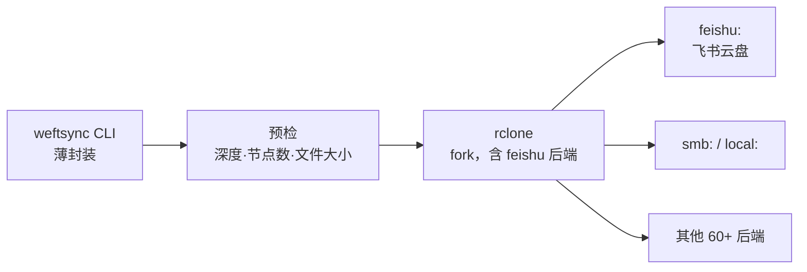

# weftsync 项目计划

> 状态：**需求已明确 · 技术路线已改定（rclone 二次开发）· 待凭据做实测**
> 最后更新 2026-11-04 ／ 决策理由见 `docs/decisions.md`

---

## 1. 需求

| # | 需求 | 要点 |
|---|---|---|
| R1 | **认证**：飞书云盘采用**飞书应用权限**（app_id + app_secret） | 不用用户 OAuth 交互登录 |
| R2 | **主方向**：本地 → 飞书云盘**单向同步** | |
| R3 | **同步模式**：完全同步、仅增量同步等可区分 | |
| R4 | **多本地机器** → 同一云盘 | 多源汇聚，需处理互相覆盖 |
| R5 | **双向同步**尽力而为；做不到则单独提供**云盘 → 本地拉取** | 因飞书云盘结构不同 |
| R6 | **后端可插拔**：默认飞书，未来换 SMB / 其他网盘 | 架构期就要预留 |
| R7 | **多网盘同步**（可选，非 pair） | 高级功能 |
| R8 | 可借鉴现有轮子，甚至二次开发 | |
| R9 | **平台**：Windows 为首要目标，**Linux 也要验证** | 双平台都要能跑 |
| R10 | **远端是公共仓库**：任何凭据不得入库 | 硬性红线 |

---

## 2. 已核实的技术事实（附来源，非推测）

> 全部来自飞书开放平台官方文档，2026-11-04 抓取。

| # | 事实 | 对设计的影响 |
|---|---|---|
| F1 | `tenant_access_token` 通过 `POST /open-apis/auth/v3/tenant_access_token/internal`（body: app_id + app_secret）获取，**有效期 2 小时**；剩余不足 30 分钟时调用会**返回新 token 且旧 token 仍有效** | 必须做 token 缓存 + 提前刷新，不能每请求都换 |
| F2 | **应用身份访问个人云盘文件夹必须先人工授权**：① 应用开启「机器人」能力 ② 建群并把应用拉进群 ③ 在飞书文档里把目标文件夹**共享给该群** | 代码无法解决，必须写进部署文档；换文件夹就要再操作一次 |
| F3 | 列目录 `GET /open-apis/drive/v1/files`，`page_size` 最大 200，**不递归**，需自己逐层递归 | 大目录树要自己遍历，注意限流 |
| F4 | 列目录返回：`token`、`name`、`type`(doc/sheet/bitable/mindnote/file/docx/folder/shortcut)、`parent_token`、`url`、`created_time`、`modified_time`、`owner_id`<br>**没有 size，没有 content hash** | ⚠️ 增量判断只能靠 `modified_time`（秒级）；无法用 hash 校验内容 → **本设计最大约束** |
| F5 | 上传 `POST /open-apis/drive/v1/files/upload_all`，**单文件 ≤ 20MB**；参数：`file_name`/`parent_type=explorer`/`parent_node`/`size`/`checksum`(Adler-32, 可选)；超限走分片上传 | 大文件必须实现分片流程 |
| F6 | 上传限流 **5 QPS、10000 次/天**；列目录 **20 QPS** | 大批量同步必须限速 + 可续传 |
| F7 | 容量硬限制：**目录最深 15 层**、**单层最多 1500 节点**、**单棵树最多 40 万节点** | 深/大目录会失败，需前置校验 |
| F8 | 权限 scope：`drive:drive`（读写管理全部）/ `drive:drive:readonly` / `drive:file` / `drive:file:upload` | 最小权限：上传场景给 `drive:file:upload` |
| F9 | 错误码：`1061004 forbidden`、`1061045 can retry`、`1062009 size 不一致`、`1061044 parent_node 不存在`、`1062506 超目录深度`、`1062507 超单层节点数` | 需分类重试策略 |
| F10 | 飞书云盘**只能按 token 寻址**（folder_token / file_token），没有真实路径；Wiki 不支持直接上传，须先传到文件夹再 move | 必须维护「逻辑路径 ↔ token」映射 |

### 2.2 rclone（来源：官方后端总览 + Go API 文档 v1.75.2）

| # | 事实 | 证据 |
|---|---|---|
| B1 | **rclone 没有飞书 / Lark 后端** | 官方 overview 逐条核对约 60 个后端，无 Feishu/Lark；在 rclone/rclone 仓库检索 `feishu` / `lark` / `open.feishu.cn` 均无结果 |
| B2 | rclone 的**能力模型足以表达飞书的缺陷** | `fs.Features` 含 `DuplicateFiles` / `CaseInsensitive` / `CanHaveEmptyDirectories` / `SlowModTime` / `PartialUploads`；`SetModTime` 是**可选接口**；`fs.ModTimeNotSupported` 常量表示 modtime 不可用 |
| B3 | **未知 size 是一等公民** | `Fs.Put` 官方注释："for unknown-sized objects (indicated by `src.Size() == -1`)"；`Directory.Items()` 亦注明 "-1 for unknown" |
| B4 | size 不可比时有全局开关 | `fs.ConfigInfo.IgnoreSize` → 命令行 `--ignore-size` |
| B5 | 跨平台单文件产物 | `GOOS=windows` / `GOOS=linux` 直接交叉编译 |
| B6 | 配置可用环境变量注入 | `RCLONE_CONFIG_<REMOTE>_<OPTION>`（`fs.ConfigToEnv`） |
| B7 | 多 remote 可组合 | `union` 后端 |
| B8 | 白拿的现成能力 | `sync`/`copy`/`check`/`dedupe`/`lsjson`、`--dry-run`、`--max-delete`、`--tpslimit`、`--retries`、`--fast-list`、filter 语法、并发（`--transfers`/`--checkers`）、进度与 JSON 日志 |

---

## 3. 上线前必须实测的 6 件事（E1–E6）

> 无法从文档确定、但会决定架构的点。**用户提供凭据后由我执行**，
> 结果连同原始返回写入 `docs/feishu-probe.md`。

| # | 待验证 | 为什么关键 | 若答案为「否」的应对 |
|---|---|---|---|
| **E1** | 已有 `file` 能否**原地更新内容**（file_token / 分享链接不变）？ | 决定 `Update()` 能否实现 | 不能 → 返回 `fs.ErrorCantUpdate`，rclone 删后重传（链接会变） |
| **E2** | 同一文件夹内是否允许**同名文件**共存？ | 决定 `Features.DuplicateFiles` 与路径唯一性 | 允许 → 路径不再唯一，rclone 会混乱，须靠 token 映射 + 拒绝写重名 |
| **E3** | `file` 类型是否真拿不到 size？能否用 `HEAD`/download 的 `Content-Length` 补？ | 决定是否必须依赖 `--ignore-size` | 能拿到 → 省掉一个大坑 |
| **E4** | 按 F2 授权后，应用是否真有**写权限**（不只读）？ | 决定 R2 是否成立 | 不行 → 前提崩塌，需换共享空间或 user token |
| **E5** | `modified_time` 的更新时机：上传时写？移动/改名会变吗？ | 决定 `--ignore-size` 后 mtime 比较是否可信 | 不可信 → 需自建 token→内容指纹映射 |
| **E6** | rclone 在 `Size()==-1` 下的**实际比较行为**，`--ignore-size` 是否真能避免每次重传 | 决定架构是否成立（**本轮最关键**） | 不成立 → 在 `List` 缓存已知 size，或改回自研 |

---

## 4. 核心设计难点

### 4.1 难点一：飞书与 SMB 能力差异巨大，「可插拔」不是抽象基类就够

| 能力 | 本地 / SMB(UNC) | 飞书云盘 |
|---|---|---|
| 寻址 | 真实路径 | 只有 token，需自己维护路径↔token |
| size | ✅ | ❓（F4 未返回） |
| content hash | ✅ 任意算法 | ❌ 服务端无 |
| mtime | ✅ 可读可写 | 只读、秒级、口径不明 |
| 原地覆盖 | ✅ | ❓（E1） |
| 原子 rename | ✅ | 只能 move，且可能改 mtime |
| 递归列目录 | ✅ 一次遍历 | ❌ 逐层 API + 限流 |
| 限流 | 无 | 上传 5 QPS |

**结论**：能力声明确实必须有 —— 但 rclone 已经内建了这套模型：
`fs.Features` + 可选接口 + `Size() == -1`（见 2.2 的 B2/B3）。**不需要自己再设计一遍。**

### 4.2 难点二：增量同步没有可靠判据

飞书端只有秒级 `modified_time`，没有 size / hash。「远端是否变化」只能看时间戳，存在三类误判：
内容变了但 mtime 没变、mtime 变了但内容没变、同秒内多次修改。

**在 rclone 里的对策**：`--ignore-size` 关闭 size 比较，退回 mtime 窗口比较。
但「本地文件 mtime」与「飞书 `modified_time`」是否在同一语义下可比，**必须靠 E5/E6 实测确认**。
若不可比，则 `--checksum` 也走不通（飞书无 hash），只能自建 token→指纹映射。

> ⚠️ B3 的副作用：本地文件有真实 size、飞书返回 -1 → 默认比较会认为「总是不同」
> → **每次全量重传**。这是 E6 必须验证的核心风险。

### 4.3 难点三：多机器同步同一云盘 = 天然写冲突

R4 要求多台机器同步到同一云盘。没有分布式锁，必须定义冲突策略：

| 策略 | 对应 rclone 参数 |
|---|---|
| 只补不覆盖 | `--ignore-existing` |
| 跳过更旧的 | `--update` |
| 冲突留副本 | `--backup-dir` + `--suffix` |
| 删除保险网 | `--max-delete N`（超 N 个删除即中止） |

默认组合建议：`--update --max-delete 50`。

### 4.4 难点四：删除是单向同步里最危险的动作

「完全同步」与「镜像」的区别就在是否删除远端多余文件。**默认绝不删除**，
必须显式 `--delete`，并加 `--max-delete=N` 熔断（超 N 个即中止），
防止「本地目录配错 → 一键清空云盘」。

---

## 5. 架构草案



### 5.1 飞书后端要实现的 rclone 接口

| rclone 概念 | 飞书实现 |
|---|---|
| `NewFs(root)` | root 路径逐层解析成 folder_token；解析失败返回 `fs.ErrorDirNotFound` |
| `List(dir)` | 调 `/drive/v1/files`；`Size()` 返回 **-1**（F4） |
| `Hashes()` | 返回 `hash.None`（F4 无 hash） |
| `Precision()` | 1 秒（F4 秒级） |
| `Features.DuplicateFiles` | 按 **E2** 实测结果设置 |
| `Put()` | ≤20MB 走 `upload_all`；>20MB 实现 `OpenChunkWriter` 分片 |
| `Update()` | 按 **E1** 结果：可原地更新则实现，否则返回 `fs.ErrorCantUpdate` |
| `SetModTime()` | **不实现**（飞书不允许改 mtime）→ rclone 自动降级 |
| 限流 | 后端内置 pacer；建议用户 `--tpslimit 5` |
| 错误码 | 把 F9 的错误码映射到 `fs.ShouldRetry` / `fserrors.RetryError` |

不再自己造 `Entry` / `Caps` / `Backend` —— rclone 的 `fs.Fs` + `fs.Features`
就是这套东西，而且所有调用方已经写好了。

### 5.2 薄封装只做 rclone 不擅长的事

1. `weftsync.toml` → rclone 参数映射（用户不必懂 rclone 的 100+ 个 flag）
2. **预检**：目录深度 ≤15（F7）、单层 ≤1500（F7）、>20MB 提示走分片（F5）、限流参数（F6）
3. 多 pair 编排与结果汇总
4. 密钥只从环境变量注入（`RCLONE_CONFIG_*`，见 B6），不写明文 `rclone.conf`

不给 rclone 加中间层，也不重新实现比较逻辑。

### 5.3 目录结构

```
weftsync/
  vendor/rclone/            # rclone fork（Go）
    backend/feishu/
      feishu.go             # Fs / Object 实现
      auth.go               # tenant_access_token 缓存与刷新
      api.go                # 各 endpoint 薄封装
      pacer.go              # 限流与重试
      feishu_test.go
  src/weftsync/             # 薄封装（Python，可选）
    cli.py                  # weftsync sync / pull / doctor
    config.py               # weftsync.toml + 环境变量
    preflight.py            # F5/F6/F7 预检
  tests/
  docs/
    feishu-probe.md         # E1–E6 实测记录（含原始返回）
```

### 5.4 配置草案

```toml
[[pair]]
name = "work-docs"

[pair.local]
root = "D:/work/docs"

[pair.remote]
backend = "feishu"          # feishu | smb | local | 任意已编译后端
root = "team/docs"          # 飞书侧逻辑路径，由后端解析成 folder_token

[pair.policy]
mode = "incremental"       # incremental | full | mirror
max_delete = 50            # 熔断（mirror 模式强制生效）
conflict = "update"        # ignore-existing | update | backup
```

凭据**不写在这个文件里**，只从环境变量取（见 `.env.example`）。

多网盘（R7）：写多段 `[[pair]]` 指向同一 `local.root`；或用 rclone 的 `union` 后端。

---

## 6. 技术选型（已改定）

| 方案 | 优点 | 缺点 | 判断 |
|---|---|---|---|
| **rclone fork + 飞书后端（Go）** | 同步引擎、限流、重试、filter、dry-run 全部白拿；60+ 后端直接复用（R6/R7）；单文件产物，Windows/Linux 同一套（R9） | 要写 Go 后端；需 Go 工具链 | ✅ **选定** |
| Python 自研引擎 | `.venv` 已就绪，迭代快 | 要把 rclone 已有的能力重写一遍，且大概率写得更差 | ❌ 已否决 |
| 现成第三方飞书同步工具 | 起步快 | 多为 user token + 双向，不符合「应用权限 + 单向 + 可插拔」 | ⚠️ 仅参考 |

> 我此前写「rclone 成本高于收益」是**错的**：依据是没有查证的两条假设（见 `docs/decisions.md` D7）。

---

## 7. 里程碑

| 里程碑 | 内容 | 验收标准 |
|---|---|---|
| **M0** | 实测 E1–E6 | 六个答案写入 `docs/feishu-probe.md`，附原始返回 |
| **M1** | rclone fork + 飞书后端**只读**（`NewFs` / `List` / `NewObject` / `Open`） | `rclone lsf feishu:` 能列出授权目录；`rclone copy feishu:X ./local` 能拉回 |
| **M2** | 上传（小文件） | `rclone copy ./local feishu:X` 成功，文件在飞书客户端可见 |
| **M3** | 分片上传 + 限流 + 重试 | >20MB 能传；`--tpslimit` 生效；触发限流能自愈 |
| **M4** | 删除 / 更新 / 移动 | `rclone sync` 行为正确；`--max-delete` 能熔断 |
| **M5** | 薄封装 CLI + `weftsync.toml` | 一条命令跑多 pair；预检能拦住超限目录/文件 |
| **M6** | **Linux 验证** | 同一套代码在 Linux 跑通 M1–M5（R9） |
| **M7** | 双向（R5） | 待 M0 结果评估 |

---

## 8. 待确认问题

| # | 问题 | 影响 |
|---|---|---|
| Q1 | **飞书应用凭据**（app_id / app_secret）+ **准许测试的文件夹** | 阻塞 M0 全部实测 |
| Q2 | 目标云盘：**个人云盘** / **共享空间（团队）** / **知识库(Wiki)** | 三者授权与上传方式不同；Wiki 不支持直接上传 |
| Q3 | 同步对象只含**普通文件**，还是也含飞书原生文档（docx/sheet/bitable）？ | 原生文档无「文件」语义，无法按字节同步 |
| Q4 | 多机同步是**同一人多设备**还是**多人**？ | 决定冲突策略默认值 |
| Q5 | 是否接受 **Go 工具链**（编译 rclone fork）？ | 决定 M1 能否开始 |

---

## 9. 本仓库约束

- **远端是公共仓库（R10）**：凭据只从环境变量 / `.env` 读；`.env` 已被 `.gitignore` 排除；
  `scripts/check_secrets.py` + pre-commit 钩子已**实测**能拦住泄露（见 `docs/decisions.md` D6）
- 位于 OneDrive 同步目录内 → `.git` 可能被锁定，遇 `index.lock` 先查 OneDrive
- PowerShell 5.1：命令用 `;` 串联；`.ps1` 一律纯 ASCII
- 临时产物写 `.scratch/`，不写 `%TEMP%`
